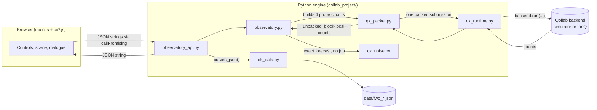

# The Free Will Observatory — Full Documentation

> **This effort is supported by Qollab & IonQ**

This is the complete, single-file version of the Free Will Observatory's documentation:
everything from the top-level [README.md](../README.md) and every file under [docs/](README.md),
merged into one place for printing, offline reading, or pasting into a single judging or
review context. The authoritative, easier-to-maintain split-file set still lives in
[docs/](README.md) — start at [docs/README.md](README.md) if you'd rather navigate
section by section. Nothing here is new content; it is the same text, numbers and caveats,
reorganized into one document with in-file links instead of cross-file ones.

## Table of contents

- [Overview](#overview)
  - [What it does](#what-it-does)
  - [The question](#the-question)
  - [Beyond the tutorial](#beyond-the-tutorial)
- [How to run on Qollab](#how-to-run-on-qollab)
- [Architecture](#architecture)
  - [The big picture](#the-big-picture)
  - [Module responsibilities](#module-responsibilities)
  - [One run, traced](#one-run-traced)
  - [The two Qollab entry points](#the-two-qollab-entry-points)
  - [The shipped datasets](#the-shipped-datasets)
  - [Packing in more detail](#packing-in-more-detail)
- [The model: physics and statistics](#the-model-physics-and-statistics)
  - [1. The circuit](#1-the-circuit)
  - [2. The state before readout](#2-the-state-before-readout)
  - [3. The display probability](#3-the-display-probability)
  - [4. The probes](#4-the-probes)
  - [5. The readings](#5-the-readings)
  - [6. Bit order](#6-bit-order)
  - [7. The Hoeffding interval](#7-the-hoeffding-interval)
  - [8. The Demon's forecast and the baselines](#8-the-demons-forecast-and-the-baselines)
  - [9. Noise](#9-noise)
  - [10. What this does NOT show](#10-what-this-does-not-show)
  - [11. The contract in brief](#11-the-contract-in-brief)
- [Claims and validation](#claims-and-validation)
  - [Exact checks](#exact-checks)
  - [Resolution rule and common assumptions](#resolution-rule-and-common-assumptions)
  - [Card A: Intentions move the odds across the full range at zero coupling](#card-a-intentions-move-the-odds-across-the-full-range-at-zero-coupling)
  - [Card B: At full coupling the Self is 50/50 for every intention and Capacity vanishes](#card-b-at-full-coupling-the-self-is-5050-for-every-intention-and-capacity-vanishes)
  - [Card C: Coupling writes information into the World](#card-c-coupling-writes-information-into-the-world)
  - [Toolkit validation on CHSH](#toolkit-validation-on-chsh)
- [UI and frontend](#ui-and-frontend)
  - [Files](#files)
  - [Structure and flow](#structure-and-flow)
  - [Visual mappings](#visual-mappings)
  - [Drawn scenes for the design themes](#drawn-scenes-for-the-design-themes)
  - [Stub mode (local testing)](#stub-mode-local-testing)
  - [Sprite portraits](#sprite-portraits)
  - [Accessibility checklist](#accessibility-checklist)
  - [Known limits](#known-limits)
- [Development and testing](#development-and-testing)
  - [Setup](#setup)
  - [Running the tests](#running-the-tests)
  - [The smoke test](#the-smoke-test)
  - [Research scripts (lab/)](#research-scripts-lab)
  - [Build and packaging scripts (tools/)](#build-and-packaging-scripts-tools)
  - [Packaging for Qollab](#packaging-for-qollab)
  - [The dev/ harness](#the-dev-harness)
  - [Running the Python console entry locally](#running-the-python-console-entry-locally)
  - [Extending the project](#extending-the-project)
- [Design brief and inspiration](#design-brief-and-inspiration)
  - [Inspiration: Laplace's Demon and the limits of calculation](#inspiration-laplaces-demon-and-the-limits-of-calculation)
  - [Goal and audience](#goal-and-audience)
  - [Non-negotiable constraints](#non-negotiable-constraints)
  - [Measurable targets](#measurable-targets)
  - [Creative freedom](#creative-freedom)
  - [Acceptance gate after every pass](#acceptance-gate-after-every-pass)
- [Platform notes](#platform-notes)
  - [Python projects](#python-projects)
  - [JS projects](#js-projects)
  - [Backends](#backends)
  - [IonQ noise model](#ionq-noise-model)
- [Design-tool prompt log](#design-tool-prompt-log)
- [Honesty: what this is and is not](#honesty-what-this-is-and-is-not)
- [Credits, provenance and license](#credits-provenance-and-license)

---

## Overview

*A fictional instrument for exploring the capacity to reshape possible futures.*

**In one sentence:** a single-page, brain-shaped graph where three personas investigate one
two-qubit Self through fresh simulator experiments, visible changes in probability, and a
transparent model of agency.

You set an **Intention**, press **Run experiment**, and watch the distribution of the Self's
two possible futures move. Turn up the **World coupling** and the future stays just as
uncertain, but your intention stops moving it. **The same 50/50 outcome is high-capacity in
one setting and zero-capacity in another.** Three personas (The Self, Laplace's Demon, The
Observer) read the same data differently. Every number on the page comes from one freshly
submitted simulator job of four two-qubit Qiskit circuits, and every reading has an exact
definition, a closed-form prediction and a conservative error bar.

> **Honesty, first.** The correspondence between controls and words is *designed, not
> discovered*. Simulators compute what quantum theory predicts (and how a noise model
> degrades it); they do not test nature. The readings are a fictional model, not a
> measurement of free will, not neuroscience, and not proof of agency: a responsive
> classical model scores just as high. See [Honesty](#honesty-what-this-is-and-is-not).

| Judging trait | Where to look |
|---|---|
| Novelty & creativity | [What it does](#what-it-does), [The question](#the-question), [Beyond the tutorial](#beyond-the-tutorial) |
| Technical execution | [How to run on Qollab](#how-to-run-on-qollab), [The model](#the-model-physics-and-statistics), [Claims and validation](#claims-and-validation), the test suite ([Development and testing](#development-and-testing)) |
| Impact potential | [Beyond the tutorial](#beyond-the-tutorial), [Development and testing](#development-and-testing) |
| Documentation quality | This document (and the split-file set at [docs/README.md](README.md)), [BUILDLOG.md](../BUILDLOG.md), [CREDITS.md](../CREDITS.md) |

**Links:** Qollab project: TODO(captain). Demo video (2–3 min, public link): TODO(captain).
Source: TODO(captain).

**Why "Laplace's Demon"?** One of the three personas is named for Pierre-Simon Laplace's
1814 thought experiment about a calculating intellect that could predict the whole universe
from one instant's data — the classical picture of determinism that Bell-inequality
experiments are the modern rebuttal to. The Observatory borrows the name because its own
Demon persona *does* compute an exact forecast from the quantum state before any shots are
taken, and the project's central question — is a known probability distribution the same
thing as an open future? — is a dramatized descendant of that older argument. The full story,
with the appropriate caveats about what it does and doesn't prove, is in
[Inspiration: Laplace's Demon and the limits of calculation](#inspiration-laplaces-demon-and-the-limits-of-calculation).

### What it does

**The scene.** A brain-shaped graph (two fixed lobes; the decorative nodes are *not* qubits)
holds one fictional Self. Two branches leave it, **Future 0** and **Future 1**, sized by the
measured probabilities of the last run. A **World bridge** rises from a second qubit, the
World, into the Self; its width and opacity follow the measured Connection reading. The
previous run stays as a dashed outline, so a change is a comparison, never a flourish. The
picture's sizes and weights change only when a fresh job returns; the slow drift, the particle
flow and the bridge's shimmer are decoration, off under reduced motion or with the Motion box
unticked.

**Four page styles.** The page opens in style D (blueprint, light); the Style button at the end
of the hackathon line opens a side panel to switch to A (night observatory), B (instrument
console) or C (luminous anatomy). Each style draws the same data in its own way.

**Three personas, one data set.** Switching persona changes the explanation, never the data.
Each guide speaks in an RPG-style dialogue box, and only about what it can see; a short
opening scene introduces them.

| Persona | What they do | What it reveals |
|---|---|---|
| **The Self** | Changes the Intention and presses *Run experiment*. | The current future distribution, plus the Capacity available under opposite intentions. |
| **Laplace's Demon** | Forecasts the chosen settings before the job returns. | The closed-form prediction next to the fresh sample, plus two labelled classical baselines (fixed output: Capacity 0, Openness 0; fair coin: Capacity 0, Openness 1). |
| **The Observer** | Changes the Perspective and reruns. | A different observable for the same prepared state. Capacity stays comparable because its two probes share the readout. |

**Three controls** (angles in radians; see [The model](#the-model-physics-and-statistics)):

| Control | What it is in the circuit | Range (default) |
|---|---|---|
| Intention | a phase φ on the Self: `RZ(φ)` | 0 to 2π (π/2) |
| World coupling | a slider w; γ = w·π/2; a controlled-`RY(2γ)` from Self to World | 0 to 1 (0) |
| Perspective | the equatorial readout angle β: `RZ(−β)`, `H`, measure Z | 0 to π (0) |

**Three readings**, each computed from raw counts, never from the animation:

| Reading | Question it answers | Definition | Range |
|---|---|---|---|
| **Capacity C** | How far can opposite intentions move P(Self = 1)? | \|p_high − p_low\| from the two intent probes, with a conservative 95% interval | 0 to 1 |
| **Openness O** | How uncertain is the current Self outcome? | binary entropy of the display P(Self = 1) | 0 to 1 bit |
| **Connection I** | How much does a reference World measurement reveal about the Self? | mutual information of the separate connection probe | 0 to 1 bit |

Under the scene: the three readings, a before/after probability chart, one factual sentence
plus one line in the persona's voice, and a **How this works** drawer with the circuit, the
four probes' counts, the job record and the formulas.

### The question

Is uncertainty the same thing as freedom? This project gives the fiction a precise rule and
lets you test it. *Free will, here, is defined as the capacity to reshape possible futures:*
the Self has a distribution of outcomes, an intention is a control input that can redirect
that distribution, and freedom within the model is the **range of redistribution** available
to that input. One surprising outcome is never enough; the model asks whether an
intervention changes the odds across repeated experiments.

**The central result.** Two situations both look 50/50:

| Setting | P(Self = 1) | Openness | Capacity (ideal) | The model's verdict |
|---|---|---|---|---|
| no coupling (w = 0), intention π/2 | 0.5 | 1 bit | **1.0** (intentions sweep 0% → 100%) | high-capacity |
| full coupling (w = 1), *any* intention | 0.5 | 1 bit | **0.0** (every allowed intention gives 50/50) | low-capacity |

In the model, uncertainty alone is not freedom. The ideal Capacity is cos γ: it falls from 1
to 0 as the World records which alternative the Self took, while the Self's own odds never
leave 50/50. That contrast is the whole show, and it reproduces to floating-point rounding
([Claims and validation](#claims-and-validation)).

### Beyond the tutorial

All three of the rules' routes, in this order of weight:

1. **A novel application and problem context.** A precise, falsifiable toy model of "the
   capacity to reshape possible futures", staged as an instrument with three personas, where
   the same 50/50 outcome is high-capacity in one setting and zero-capacity in another.
   Nobody's tutorial asks whether uncertainty is freedom.
2. **An original analytical and educational contribution.** The capacity law C = cos γ for
   this control family; a Hoeffding-bounded Capacity interval with a fixed "no resolved
   influence" rule and a measured coverage check; the Demon's forecast against the sample;
   two labelled classical baselines; claim cards that say what each number does *not* show.
3. **A technical extension.** Four probes and two canary checks packed into one 17-qubit
   job (IonQ's one-job-per-run rule), an exact in-browser noise model with an IonQ-like
   preset shown next to the ideal prediction, and a one-job guard that is tested.

**Who might use it:** educators teaching interference versus decoherence with one dial;
philosophy-of-mind classes that want a model precise enough to argue with; science
communicators; other Qollab projects reusing the one-job packer and canaries.

---

## How to run on Qollab

**Ready to upload:** [`build/upload-js.zip`](../build/upload-js.zip) (the same files
unpacked: [`build/upload-js/`](../build/upload-js/)). On Qollab, click **New Project**,
choose **Upload your own files**, drop the zip on the card (it shows 30 files and a JS
project), then **Create**.

Open the project on Qollab, keep the **built-in simulator** in the Run dialog, press
**Run**, then use the page: choose a persona, move the three sliders, press **Run
experiment**. The first run on the defaults (Intention π/2, coupling 0, perspective 0,
1,024 shots per probe) is Act 1 of the demo.

| Entry | Files | What you get |
|---|---|---|
| **JS page (the submission)** | top-level `index.html` (a body fragment) + `main.js` + `main.css` + `ui/*.js`, with `observatory.py`, `observatory_api.py`, the `qk_*.py` toolkit and `data/*.json` | Qollab runs the JS entry whenever both top-level `index.html` and `main.js` exist. The page uses only the injected `backend`, our Python modules (`import * as api from "observatory_api"`, JSON strings both ways) and three.js from Qollab's import map. Nothing runs outside the browser: no server, no polling API, no API keys, no bundler. |
| **Python console (fallback)** | `main.py` + the same Python modules and data | Used only when the JS entry files are absent (`tools/pack_for_qollab.py --entry python` leaves them out). Qollab's Run-settings form shows `main()`'s parameters: `intention_deg` (90), `world_coupling` (0), `perspective_deg` (0), `shots_per_probe` (1024), `persona` (`self`). Output: backend profile, the Demon's forecast, one run's four count tables, the three readings with the interval, the explanation, the baselines. |

Build either upload with `tools/pack_for_qollab.py --entry js` or `--entry python`; see
[SUBMIT.md](../SUBMIT.md).

**Backends** (Qollab's Run dialog):

| Backend | Kind | Notes |
|---|---|---|
| Built-in simulator | ideal, local | Qiskit `BasicSimulator`, 24 qubits. **Free and local: the backend judges press Run on.** |
| AWS Braket local | ideal, local | 25 qubits |
| IBM noise models | noisy, local (in the browser) | circuits are transpiled first; `mode=auto` sends the three canary blocks and four probes as one list job of 7 small circuits |
| IonQ Forte 1 / Forte Enterprise 1 (simulator) | noisy, remote | 29 qubits, **one job per run**; the four probes and the canaries travel in that one job |

**One job per run.** Each press of *Run experiment* submits exactly one `backend.run(...)`
holding all four probes (`display`, `intent_low`, `intent_high`, `connection`) plus two
canary checks: an orientation block (prepared `110`, a key that is not a palindrome, so a
reversed bit order is diagnosed rather than absorbed) and a readout calibration (flip rates
P(1|0) and P(0|1), reported, not corrected). With `mode=auto` the probes are tiled side by
side on disjoint qubits of **one 17-qubit circuit** (8 qubits for the probes, 9 for the
canaries) on one-job backends and on the built-in simulator, and sent as one list job on the
in-browser noise models. A guard in `qk_runtime.run_once` refuses a second submission on a
one-job backend before anything reaches the provider (verified: the second call returns
`status: failed` with the guard's message and the job count stays at 1).

**Shots.** 1,024 per probe by default (4,096 sampled circuit executions per click), capped
at 4,096 per probe. The metrics use the shots actually seen per probe (IonQ's noisy
simulators report counts as round(probability × shots), so totals can differ slightly).

**Run settings** (JS page and Python entry alike): `intention_rad` [0, 2π],
`world_coupling` [0, 1], `perspective_rad` [0, π], `shots_per_probe` [1, 4096], `persona`
(`self` / `demon` / `observer`), `mode` (`auto` / `tile` / `list`), `canary` (bool).
Out-of-range or ill-typed values (beyond a 10⁻⁹ rounding allowance at the upper limits)
return a visible *failed* result before any job is submitted; old counts are never
substituted for a live run.

---

## Architecture

How the Observatory is put together, end to end: the Python engine's module layout, the
path from circuit to screen, the two Qollab entry points, and how the shipped datasets are
produced and loaded.

### The big picture



One user action ("Run experiment") becomes exactly one `backend.run(...)` call carrying four
probe circuits plus canary blocks, packed into whatever shape the backend needs. Everything
downstream of that call — unpacking, bit-order correction, the three readings, the Hoeffding
interval, the persona explanations — is pure Python with no further quantum execution.

### Module responsibilities

| Module | Role | Imported by |
|---|---|---|
| `observatory.py` | The physics and the fiction: settings validation, circuit construction (`make_circuit`, `probes`), bit-order correction (`canonical_counts`), the three readings and their interval, the exact/closed-form model, the persona explanation text, and `run()` — the one function that drives an actual job. | `observatory_api.py`, `main.py` |
| `observatory_api.py` | The JSON bridge the browser calls: `profile_json`, `predict_json`, `run_json`, `explain_json`, `curves_json`. Every function takes/returns JSON strings, never raises, and loads the shipped datasets by literal path. | `main.js` (as `observatory_api`), `main.py` |
| `qk_runtime.py` | The Qollab harness: classifies whatever `backend` object was injected (`backend_profile`), decides the packing mode (`preferred_mode`), transpiles if needed (`prepare`), and enforces **one `backend.run` per run** (`run_once`, `begin_run`, `jobs_submitted`). Never constructs a backend. | `observatory.py`, `qk_packer.py`, `qk_mitigation.py` |
| `qk_packer.py` | Lays out one or more circuit "blocks" (a circuit plus the qubits to measure) into a single submission — `tile` (all blocks side by side on one circuit), `list` (one circuit per block, one list job) or `tiles` (first-fit packing into multiple tiles). Adds the orientation and readout-calibration canary blocks and unpacks block-local counts afterward. | `observatory.py` |
| `qk_noise.py` | The exact in-browser noise dial: evolves the full density matrix under depolarizing gate noise and classical readout flips, for circuits small enough to afford it (`MAX_QUBITS = 10`). Backs the Demon's "IonQ-like" forecast and the shipped noise curve. | `observatory.py`, `observatory_api.py` |
| `qk_data.py` | Dataset plumbing: builds, serializes and validates the `data/fwo_*.json` files (schema tag, generator, git commit, timestamp, library versions, machine class), and provides `json_safe` (NaN/inf → null) for every JSON response. | `observatory_api.py`, `lab/sweep.py` |
| `qk_primitives.py`, `qk_bounds.py`, `qk_estimators.py`, `qk_mitigation.py`, `qk_cards.py` | A general Bell/CHSH toolkit (Bell-state prep, classical/quantum bound computation, witness estimators, readout and ZNE mitigation, claim-card rendering), built and validated end to end on the CHSH reference project before the Observatory existed. Shipped alongside the Observatory (see [SUBMIT.md](../SUBMIT.md) §4) for reuse, and exercised by `tests/` and `reference/chsh/`, but **not called by the Observatory's own run path** — `observatory.py` only reaches into `qk_data`, `qk_noise`, `qk_packer` and `qk_runtime`. | `reference/chsh/`, `tests/`, `smoke/` |

The toolkit split matters for anyone extending the project: the Observatory-specific physics
lives entirely in `observatory.py`; everything it calls below that line is backend plumbing
general enough to run a different circuit family (see [Extending the project](#extending-the-project)
for the CHSH-probe extension idea tied to the wave–particle-duality note in
[The model](#the-model-physics-and-statistics)).

### One run, traced

1. **Browser → Python.** `main.js` calls `api.run_json.callPromising(backend, JSON.stringify(draft))`.
2. **Validate.** `observatory_api.run_json` parses the JSON, calls `observatory.validate_settings`
   (raises `ValueError` on anything out of range or ill-typed — before any job is touched),
   and classifies the backend via `qk_runtime.backend_profile`.
3. **Build.** `observatory.probes(settings)` builds the four `qk_packer.Block`s (`display`,
   `intent_low`, `intent_high`, `connection`), each a 2-qubit `QuantumCircuit` from
   `make_circuit`.
4. **Pack.** `qk_packer.pack(blocks, max_qubits, mode, canary=True)` lays the four probe
   blocks and three canary blocks onto disjoint qubits of one circuit (`mode="tile"`, the
   common case: a 17-qubit circuit, 8 probe qubits + 9 canary qubits) or as one list job of
   7 small circuits (`mode="list"`, used for the in-browser IBM noise models).
5. **Prepare and run.** `qk_runtime.prepare` transpiles if the backend needs it;
   `qk_runtime.run_once` makes **the one** `backend.run(...)` call, raising before submission
   if a one-job backend (IonQ) has already been used this page load.
6. **Unpack and correct.** `qk_packer.unpack` splits the returned counts back into per-block,
   block-local (Qiskit bit order) dictionaries; `observatory.canonical_counts` reverses each
   two-bit key exactly once into the app's SelfWorld convention.
7. **Read out.** `observatory.metrics(counts)` computes Capacity (with its Hoeffding 95%
   interval and `resolved` flag), Openness and Connection; `observatory.prediction` computes
   the same readings exactly (no sampling) for the Demon's forecast; `observatory.explanation`
   turns both into the factual sentence and the three persona lines.
8. **Back to the browser.** `observatory_api.run_json` assembles the full result dict (status,
   settings, source/provenance, counts, metrics, prediction, explanation, baselines) and
   serializes it with `qk_data.json_safe` so no NaN/Infinity ever reaches `JSON.parse`.
9. **Render.** `main.js` and `ui/readings.js`/`ui/scene.js`/`ui/chart.js` turn the result into
   the futures, the readings cards, the chart, the drawer and the 3D (or flat-plate) scene.

Every step before the `backend.run` call is deterministic and re-checkable offline; only
step 5 touches an actual simulator or remote job, and it happens exactly once per click.

### The two Qollab entry points

Qollab inspects the uploaded project and prefers the JS entry if both exist:

| Entry | Files | Which code runs |
|---|---|---|
| **JS page** (the submission) | top-level `index.html` + `main.js` + `main.css` + `ui/*.js`, plus every `.py` module and `data/*.json` | `main.js` calls `observatory_api` directly in the browser tab (Pyodide); no server, no polling, nothing runs outside the browser. |
| **Python console** (fallback) | `main.py` + the same Python modules and data | Qollab's own harness builds a `backend` global, then runs `main.py`'s top-level code, then calls `main(intention_deg, world_coupling, perspective_deg, shots_per_probe, persona)` with literal defaults read from the signature. `main.py` imports `observatory` and `observatory_api` directly and prints a console report. |

Both entries share one engine; `tools/pack_for_qollab.py` decides which files to upload for
which entry (see [Packaging for Qollab](#packaging-for-qollab)). The platform's specific
rules for each form — why `main.py` must never call `main()` itself, how data files are
detected, the JS import map, iframe restrictions — are catalogued in
[Platform notes](#platform-notes); this section only covers how this project's own code uses
those rules.

### The shipped datasets

Three small JSON files travel with the project so the page can show precomputed curves
without recomputing them in the session (`qollab_project/data/`), and are loaded by literal
path (that is how Qollab decides which files to bundle); if a file is missing, the page
computes the exact curve in the session and says so:

| File | Produced by | Shape | Used for |
|---|---|---|---|
| `fwo_theory.json` | `lab/sweep.py --experiment fwo_theory` | 101 rows over `w` ∈ [0, 1]; each row has `params.w` and the exact `capacity`, `p_low`, `p_high`, `connection_bits`, `openness_bits`, `p_self_1` | The theory curve in the "How sure can we be" drawer |
| `fwo_noise.json` | `lab/sweep.py --experiment fwo_noise` | 40 rows over `scale` (0–80×) × `w` ∈ {0, 0.5}; adds `capacity_ideal`, `capacity_loss`, `noise_effective` | The Demon's noise-degradation view |
| `fwo_coverage.json` | `lab/sweep.py --experiment fwo_coverage` | 5 rows over `w` ∈ {0, 0.25, 0.5, 0.75, 1}; `capacity_exact`, `coverage_95`, `mean_width`, `resolved_fraction` from 2,000 seeded runs each | The calibration table proving the Hoeffding interval's coverage |

Every file is a `qk_data`-schema dataset: it carries its own generator command, git commit,
UTC timestamp, library versions and **machine class** (a 48-thread x86 workstation; Python
3.14, qiskit 2.5.2; qiskit-aer 0.17.2 for cross-checks), so a number quoted in
[Claims and validation](#claims-and-validation) can be traced back to exactly how it was
produced. `observatory_api._theory_curve` / `_noise_curve` / `_coverage` load each file by a
**literal** relative path (`open("data/fwo_theory.json")`) — Qollab's uploader only bundles a
data file when its path appears as a string literal in the scanned source, so an f-string or
`os.path.join` here would silently ship a page that falls back to computing the curve live.
If a file is genuinely missing, each loader recomputes the exact curve in the session and
labels the result `"computed in this session"` rather than failing.

### Packing in more detail

`qk_packer.pack` is the one place that turns "four logical circuits plus two canary checks"
into "one `backend.run` call," because IonQ allows exactly one job per run and the built-in
simulator benefits from the same discipline:

- **`tile`** — every block's qubits are mapped onto disjoint qubits of a single wide circuit,
  each with its own classical register slice. One circuit, one job. This is what `mode=auto`
  picks for one-job backends and the built-in simulator (17 qubits total: 8 for the four
  2-qubit probes, 9 for the three canary blocks).
- **`list`** — each block becomes its own small circuit, and all of them are submitted
  together as one list-valued `backend.run([c1, c2, ...])` call — still one job, but many
  small circuits instead of one wide one. Chosen for the in-browser IBM noise models, whose
  density-matrix simulator runs several 2–3-qubit circuits far faster than one 17-qubit tile.
- **`tiles`** — a fallback when the blocks don't all fit one backend's `max_qubits`: first-fit
  packing into as few wide tiles as needed, still submitted as one list job.

Two canary blocks ride along whenever `canary=True` (the default): an **orientation** block
prepared as a non-palindromic bit pattern (`110`) so a reversed or scrambled qubit→clbit map
is diagnosed rather than silently absorbed, and **readout-calibration** blocks (all-|0⟩,
all-|1⟩) that measure the per-bit flip rates `P(1|0)` and `P(0|1)`. These are reported in the
run record (`bit_order_check`), never silently corrected.

---

## The model: physics and statistics

The exact two-qubit experiment behind the Free Will Observatory, every reading's definition,
the bit-order rule, the uncertainty interval, and what none of it shows. The fiction is
intentional; the circuit behaviour underneath it is reproducible, and this section is the
specification the code implements (`model_version` = `fwo-1`). Numbers marked *measured*
were produced by the code in this repository (CPython 3.14.4, qiskit 2.5.2, numpy 2.5.3);
the full tables with seeds are in [Claims and validation](#claims-and-validation).

**Conventions.** Self = q0, World = q1, both start in |0⟩. Ket order is **Self, World**
throughout. All internal angles are radians. The user-facing slider w maps to the coupling
angle γ = w·π/2.

### 1. The circuit

| Control | Operation | Range (default) | Why it earns its name |
|---|---|---|---|
| Intention | `RZ(φ)` on the Self | 0 to 2π (π/2) | varying the phase changes how the two alternatives recombine |
| World coupling | controlled-`RY(2γ)`, control Self, target World | w: 0 to 1 (0) | it correlates the Self with a second system |
| Perspective | `RZ(−β)` then `H` on the Self, then measure Z | 0 to π (0) | it changes the measured observable |

Circuit order:

```
prepare |00>
H(Self)
RZ(phi, Self)
controlled-RY(2*gamma, control = Self, target = World)
RZ(-beta, Self)
H(Self)
measure Self and World
```

The controlled rotation is written with standard gates only, so every backend (and IonQ's
compiler) takes it unchanged: `RY(γ)` on the World, `CX(Self → World)`, `RY(−γ)` on the
World, `CX(Self → World)`. That is the standard decomposition of Qiskit's `CRYGate(2γ)`
(control/target convention as in its API reference); *measured:* the block's unitary
matches `CRYGate(2γ)` to a maximum element difference of 1.6×10⁻¹⁶ over 25 values of γ in
[0, π/2]. The first `H` creates the alternatives; the phase controls how they recombine;
the coupling writes which-alternative information into the World; the final `RZ` and `H`
pick an equatorial measurement direction and turn interference into ordinary bit
probabilities.

The Self phase and the readout phase are different conceptual controls even though the ideal
probability depends only on their difference; the interface keeps their names distinct.

### 2. The state before readout

Dropping global phases:

1. After `H` and `RZ(φ)` on the Self: (|0⟩ + e^{iφ}|1⟩)/√2 ⊗ |0⟩.
2. The controlled rotation acts only on the Self = 1 branch, where the World becomes
   `RY(2γ)`|0⟩ = cos γ |0⟩ + sin γ |1⟩.

So, before readout,

```
|ψ> = [ |00> + e^{i phi} cos(gamma) |10> + e^{i phi} sin(gamma) |11> ] / sqrt(2)
```

*Measured:* the statevector of the unrotated circuit matches this expression, up to a global
phase, to 1.6×10⁻¹⁶ over 35 (φ, w) points.

The World's marginal is P(World = 1) = sin²γ / 2 and does not depend on φ or β. The Self's
reduced state has the off-diagonal element e^{iφ} cos γ / 2: the interference visibility
available to any equatorial readout is **cos γ**. This is coherent coupling, not a noise
slider; the information is in the World, not lost.

**Visibility and distinguishability.** The controlled rotation is
`exp(−iγ |1⟩⟨1|_Self ⊗ Y_World)`: a von Neumann pre-measurement in which the World is a
one-qubit pointer. Its two records of the Self are r₀ = |0⟩ and
r₁ = cos γ |0⟩ + sin γ |1⟩, which overlap by cos γ. Three quantities follow:

- **Capacity C = cos γ** is exactly the Self's interference visibility V (the fringe range
  of P(Self = 1) over φ).
- **The World's which-alternative distinguishability D = √(1 − cos²γ) = sin γ**, which is
  also the concurrence of the pure Self–World state.
- **C² + D² = 1**: the slider rides along the wave–particle duality relation V² + D² ≤ 1
  (Greenberger & Yasin 1988; Jaeger, Shimony & Vaidman 1995; Englert 1996), saturated here
  because the state is pure. Under the noise dial (§9) V falls below cos γ and the relation
  becomes a strict inequality.

So "World coupling" is the strength of a which-alternative detector, and Capacity is the
visibility it trades away. The slider is linear in the angle, not in capacity or information:
at w = 0.5, C = 0.707 and the reference-basis connection is 0.311 bits. Two honesty points:
the coupling is unitary and reversible, so joint control of Self and World could uncompute
it and restore full capacity (the "constraint" at w = 1 is relative to Self-only controls);
and the World is one qubit whose record is fully readable by the connection probe, unlike a
many-body environment whose records are effectively irreversible.

*Measured:* at w ∈ {0, 0.25, 0.5, 0.75, 1} the engine's capacity equals the record overlap
and cos γ, the concurrence equals sin γ, and C² + D² = 1 to 10⁻¹² (a test checks it).

### 3. The display probability

Write θ = φ − β. `RZ(−β)` turns e^{iφ} into e^{iθ} (up to a global phase). `H` on the Self
maps |0⟩ → (|0⟩ + |1⟩)/√2 and |1⟩ → (|0⟩ − |1⟩)/√2. Collecting the Self = 1 amplitudes:

| Outcome (Self, World) | Amplitude | Probability |
|---|---|---|
| (1, 0) | (1 − e^{iθ} cos γ) / 2 | (1 − 2 cos γ cos θ + cos²γ) / 4 |
| (1, 1) | −e^{iθ} sin γ / 2 | sin²γ / 4 |
| (0, 0) | (1 + e^{iθ} cos γ) / 2 | (1 + 2 cos γ cos θ + cos²γ) / 4 |
| (0, 1) | e^{iθ} sin γ / 2 | sin²γ / 4 |

Adding the first two rows (cos²γ + sin²γ = 1):

```
P(Self = 1) = [ 1 - cos(gamma) * cos(phi - beta) ] / 2
```

At zero coupling (γ = 0) the intention sweeps P(Self = 1) from 0 (θ = 0) to 1 (θ = π). At
full coupling (γ = π/2) the Self marginal is 1/2 for every intention and every perspective.

*Measured:* over a grid of 13 φ × 9 w × 7 β = 819 settings, the exact statevector
probabilities differ from the closed forms by at most 3.3×10⁻¹⁶ for P(Self = 1),
1.1×10⁻¹⁶ for p_low and p_high, 1.7×10⁻¹⁶ for Capacity against cos γ and 3.3×10⁻¹⁶ for
Connection against the formula of [§5](#5-the-readings). (The team's design note reported the
same grid size agreeing to better than 1.1×10⁻¹⁵ with its own implementation.)

### 4. The probes

Four two-qubit circuits make one run, submitted together as one job. Their names and
results are kept separate.

| Probe | Settings | Purpose |
|---|---|---|
| `display` | user φ, γ, β; full circuit | drives the visible future distribution; the source of Openness |
| `intent_low` | φ = β; same γ and β | one end of the accessible probability range: ideal p_low = (1 − cos γ)/2 |
| `intent_high` | φ = β + π; same γ and β | the opposite end: ideal p_high = (1 + cos γ)/2 |
| `connection` | user φ and γ; **no** final `RZ(−β)`/`H`; measure both qubits in Z | shared information in a fixed reference basis; the source of Connection |

Default 1,024 shots per probe (4,096 sampled executions per click), capped at 4,096 per
probe. Angles above 2π are equivalent modulo 2π. Capacity is never estimated by comparing
history entries with different coupling or readout settings: both intent probes always come
from the same job as the display probe.

**Packing.** With `mode=auto` on one-job backends and on the built-in simulator, the four
probes and the three canary blocks ([§6](#6-bit-order)) are tiled on disjoint qubits of one
17-qubit circuit (9 canary qubits + 8 probe qubits) and submitted as one circuit; on the
in-browser IBM noise models they go as one list job of 7 small circuits, which those
density-matrix simulators run far faster than one wide tile. Either way it is one
`backend.run`.

### 5. The readings

Raw counts are stored first; every metric is computed from counts, never from the
animation. p is a probability estimated as counts / shots seen.

| Reading | Exact calculation | Interpretation | Ideal value |
|---|---|---|---|
| **Capacity C** | \|p_high − p_low\| from the two intent probes | total variation distance between the two binary Self distributions; the primary fictional agency measure, 0 to 1 | cos γ |
| **Openness O** | −p·log₂p − (1 − p)·log₂(1 − p) with 0·log₂0 = 0, on the display p = P(Self = 1) | uncertainty of the current Self outcome, 0 to 1 bit. Uncertainty is **not** capacity. | h([1 − cos γ cos θ]/2) |
| **Connection I** | Σ_{s,w} p(s,w)·log₂[p(s,w) / (p(s)·p(w))] over the connection probe's counts only, skipping zero terms | classical mutual information between Self and World in the reference measurement, 0 to 1 bit; not a general entanglement witness | h(sin²γ/2) − ½·h(sin²γ) |

h(x) = −x·log₂x − (1 − x)·log₂(1 − x) is the binary entropy. In the connection probe the
ideal joint distribution (SelfWorld keys) is p(00) = 1/2, p(01) = 0, p(10) = cos²γ/2,
p(11) = sin²γ/2, so the Self marginal is 1/2 whatever the coupling, and I depends on γ only.

Ideal values at the settings used in the demo (β = 0):

| w | γ | p_low / p_high | C | I (bits) | display p at φ = π/2 | O at φ = π/2 |
|---|---|---|---|---|---|---|
| 0 | 0 | 0.0000 / 1.0000 | 1.0000 | 0.0000 | 0.5 | 1 bit |
| 0.5 | π/4 | 0.1464 / 0.8536 | 0.7071 | 0.3113 | 0.5 | 1 bit |
| 1 | π/2 | 0.5000 / 0.5000 | 0.0000 | 1.0000 | 0.5 | 1 bit |

At φ = π (still w = 0) the display p is 1 and O is 0 bits while C stays 1: predictability
and capacity coexist. These numbers are closed-form consequences of the formulas above, not
run results; the shrinking p_low/p_high range is the quantity the capacity probes estimate.

*Measured* (Qiskit `BasicSimulator`, `seed_simulator=11`, 1,024 shots per probe, one job
per row; the samples on Qollab are fresh each run):

| w | φ | p_low / p_high | C [95% interval] | Resolved | I (bits) | display p | O (bits) |
|---|---|---|---|---|---|---|---|
| 0 | π/2 | 0.0000 / 1.0000 | 1.0000 [0.9075, 1.0000] | yes | 0.0000 | 0.485 | 0.999 |
| 0 | π | 0.0000 / 1.0000 | 1.0000 [0.9075, 1.0000] | yes | 0.0000 | 1.000 | 0.000 |
| 0.5 | π/2 | 0.1494 / 0.8652 | 0.7158 [0.6233, 0.8083] | yes | 0.2895 | 0.516 | 0.999 |
| 1 | π/2 | 0.5156 / 0.4854 | 0.0303 [0.0000, 0.1228] | **no** | 0.9989 | 0.525 | 0.998 |

The readings are never averaged into a single "free will percentage". When Capacity is shown
as a percentage it is labelled *Capacity in this model* and defined in the drawer.

### 6. Bit order

The app's canonical order is **SelfWorld**: `10` means Self = 1, World = 0, and
p = [counts[`10`] + counts[`11`]] / N, with absent outcomes filled with zero.

Qiskit writes classical bit 0 at the **right** end of a count key. A probe measured as
[Self = q0 → c0, World = q1 → c1] therefore comes back as c1c0 = **WorldSelf**. The
two-bit strings are reversed **once**, at the adapter boundary between `qk_packer`'s
block-local counts and the Observatory's readings (`observatory.canonical_counts`), and
nowhere else.

The test that catches a mistake: flip q0 only (`X` on the Self, nothing on the World) and
measure. Qiskit reports the key `01`; the app must report `10` with certainty. A reversed
mapping would report `01`, and a mapping applied twice would report `01` as well.
*Measured:* through the real packing path, 256 of 256 shots came back as Qiskit `01` and
were reported as `10`, with the orientation canary passing in the same job.

Independently of that check, every job carries two canary checks from `qk_packer` (three
blocks of 3 qubits): an **orientation** block prepared as `110` (a key that is not a
palindrome, so a reversed or scrambled register is diagnosed rather than absorbed) and two
**readout calibration** blocks (all |0⟩, all |1⟩) that measure the per-bit flip rates
P(1|0) and P(0|1). The run record reports them as `bit_order_check.orientation_ok`,
`p_flip_0to1_mean` and `p_flip_1to0_mean`. The flip rates are reported, not corrected.

### 7. The Hoeffding interval

Near zero capacity the question is whether a small estimate means anything, so the interval
must be honest there.

**Setup.** For one probe with N independent shots, the indicator of Self = 1 is a bounded
random variable in [0, 1] and p̂ is its mean. Hoeffding's inequality (Hoeffding 1963) gives,
for any t > 0,

```
P( |p_hat - p| >= t ) <= 2 * exp(-2 * N * t^2)
```

**Choice of t.** Set the right-hand side to 1/40: t(N) = √(ln 80 / (2N)).

**Union bound over the two intent probes.** The probability that *either* estimate misses
by its t is at most 1/40 + 1/40 = 1/20. On the complementary event, which has probability
at least 95%,

```
|d_hat - d| <= t(N_low) + t(N_high) = e,   with   d = p_high - p_low
e = sqrt(ln(80) / (2 * N_low)) + sqrt(ln(80) / (2 * N_high))
```

**The intervals.** For the signed difference: [d̂ − e, d̂ + e], clipped to [−1, 1] because
|d| ≤ 1. For C = |d|, map the interval through the absolute value: if it spans zero, the
lower limit is 0 and the upper limit is the largest endpoint magnitude; otherwise both
limits are the endpoint magnitudes in order. A result is **resolved** when the interval
excludes zero, which is exactly |d̂| > e.

**Size.** ln 80 = 4.382. At 1,024 shots per probe, e = 2 × 0.04626 = **0.0925**; at 4,096
shots per probe, 0.0463; at 100, 0.296. The bound is distribution-free and therefore
conservative: a normal-approximation 95% interval for d at p ≈ 1/2 and 1,024 shots per
probe has half-width 0.043, about half of e. That is the price of a guarantee that holds at
every p, including the endpoints 0 and 1 where normal intervals fail (their standard error
is 0 there). N_low and N_high are the shots actually seen per probe (IonQ's noisy
simulators report counts as round(probability × shots), so totals can differ slightly from
the request).

**Measured calibration** (`lab/experiments.fwo_coverage`; 2,000 runs per point sampled from
the exact distributions with numpy's seeded generator, `--seed 1`; 1,024 shots per probe;
shipped as `data/fwo_coverage.json`):

| w | exact C | interval contained C | mean width | fraction "resolved" |
|---|---|---|---|---|
| 0 | 1.0000 | 100.0% | 0.093 | 1.000 |
| 0.25 | 0.9239 | 100.0% | 0.169 | 1.000 |
| 0.5 | 0.7071 | 100.0% | 0.185 | 1.000 |
| 0.75 | 0.3827 | 100.0% | 0.185 | 1.000 |
| 1 | 0.0000 | 100.0% | 0.111 | 0.000 |
| 0.9 (an in-session check with the same experiment; not in the shipped file) | 0.1564 | 100.0% | 0.185 | 0.999 |

Coverage well above the nominal 95% is what a Hoeffding + union bound should show; the
useful lines are the last column: an effect of 0.156 is resolved essentially always, and a
true zero was never reported as an influence in 2,000 tries.

**What the user sees.** "Capacity 0.03; conservative 95% interval 0.00–0.12." If the
interval includes zero: *"No resolved influence at this shot count."* A tiny positive
estimate is never described as proven agency, and the estimate is never forced to zero.

**What the interval assumes.** Independent, identically distributed shots within each probe
(true of the ideal and sampled simulators). It covers shot noise only: not noise-model
error, not readout bias (reported by the canary, not corrected), not the choice of model.

### 8. The Demon's forecast and the baselines

Laplace's Demon displays the derived P(Self = 1), p_low, p_high, Capacity, Openness and
Connection for the chosen settings before any result arrives (`predict_json`), and compares
them with the sampled values afterwards. It understands the probability law; it does not
see the shots in advance. (In the measured runs the sample fell within two binomial
standard deviations of the forecast in every case but one: the Observer run at β = 1.0 rad
read 0.229 against a forecast of 0.202, 2.15σ, and the Demon's line says so.) Two
theoretical classical references sit beside it, labelled as such: a **fixed-output** model
(Capacity 0, Openness 0) and an intention-independent **fair coin** (Capacity 0,
Openness 1). Their contrast explains the metric. It is not a proof that classical systems
cannot have capacity: a classical bit set by a switch has Capacity 1.

### 9. Noise

The default experiments run on an ideal simulator; the Qollab backends with noise models
(the in-browser IBM models and IonQ's cloud simulators) degrade the readings according to
*their* models. The Demon also shows an IonQ-like prediction (`noisy_ionq_like`) computed by
the project's exact density-matrix noise model with IonQ's published Forte-1 simulator
depolarizing rates (r₁q = 2.67×10⁻⁴, r₂q = 4.95×10⁻³, as documented for jobs before
September 2025) applied to our own gate decomposition. It is an approximation of IonQ's
noise, a modelled degradation, not a hardware measurement. *Computed:* Capacity 0.9888 at
w = 0 (p_low/p_high 0.0056/0.9944), 0.6992 at w = 0.5 (ideal 0.7071) and 0 at w = 1;
Connection 0.2919 bits at w = 0.5 and 0.9531 at w = 1 (ideal 0.3113 and 1). The marginal
that is already 1/2 cannot be moved by depolarizing noise, so at full coupling the noise
shows only in Connection. `data/fwo_noise.json` carries the preset scaled from 0× to 80× of
the published rates (20 steps) at w = 0 and w = 0.5: at 80× Capacity falls to 0.328 and
0.232 and Connection at w = 0.5 to 0.023 bits, which is the dial the Demon's noise view
draws.

### 10. What this does NOT show

- **Nothing about nature.** Simulators compute what quantum theory predicts and how a noise
  model degrades it. The measurements are real outputs of the simulator; the Self and its
  philosophical meaning are the team's artistic construction.
- **Not discovered, designed.** Phase is called intention, coupling is called World
  coupling (the World records which alternative the Self took; it never pushes the Self
  toward a future) and the readout angle is called perspective because each points to an
  inspectable operation. The words are labels for gates.
- **Specific to this control family:** phase changes on the Self, fixed coupling, the
  specified readout. **Joint control of Self and World could undo their coupling** and
  restore Capacity at w = 1. The score is not a universal property of the state.
- **Not a neuroscience model, and not evidence that quantum systems alone can be agents.**
  Users supply the intention input; version one has no autonomous learning or goals.
- **A responsive classical model can also score highly.** Capacity measures how far an
  external input moves the odds, which a classical switch does perfectly. Nothing here is
  proof of agency.
- **Connection is not an entanglement certification.** A classical copy of the Self bit
  into the World gives the same mutual information in the reference basis, and the display
  basis can hide correlations, which is why Connection uses its own probe.
- **"Not resolved" is not "zero".** An interval that includes zero means the shot count
  cannot see an effect smaller than about e; it is absence of evidence.
- **The interval covers shot noise only.**
- **One simulator per run.** Agreement between the closed form and a simulator is a check
  of the implementation, not of the world.

### 11. The contract in brief

`qollab_project/observatory_api.py` exposes the model to the page as JSON strings (the page
imports it as `observatory_api`; the physics lives in `observatory.py`):
`profile_json(backend, new_run)` (backend profile, preferred packing mode, one-job flag,
versions; the page passes `new_run=true` once per page load to reset the one-job guard),
`predict_json(settings)` (the ideal readings, per-probe distributions with SelfWorld keys,
the IonQ-like noisy prediction, the two baselines), `run_json(backend, settings)` (one job,
then settings, a source record with job evidence and `shots_seen`, canonical counts,
metrics with `capacity_ci95` and `resolved`, the prediction, and factual plus persona
explanations; on any exception a `failed` status with whatever is known),
`explain_json(result, persona)` (one persona's explanation for a result) and
`curves_json()` (the three shipped datasets with provenance, or an exact fallback computed
in the session). Invalid settings never raise: they come back as a `failed` record with the
reason, before any job is submitted (*measured:* `world_coupling = 1.5` → `failed`, zero
jobs). Settings: `intention_rad` [0, 2π] (default π/2), `world_coupling` [0, 1] (0),
`perspective_rad` [0, π] (0), `shots_per_probe` [1, 4096] (1024), `persona`
(`self`/`demon`/`observer`), `mode` (`auto`/`tile`/`list`), `canary` (true).

---

## Claims and validation

Every result in this project is stated as a **claim card**, a record that connects a
number to everything a reader must accept before the number means anything:

**Claim → Assumptions → Witness → Result ± se → What this does NOT show → Counterarguments**

The format comes from the toolkit's claim cards (`qollab_project/qk_cards.py`), validated
on the CHSH reference in [reference/chsh/](../reference/chsh/). The three cards below are
the Observatory's only empirical claims; the philosophical framing in
[Design brief and inspiration](#design-brief-and-inspiration) is narrative, not a claim. The
run record (`run_json`) carries the same readings, interval and explanation text that these
cards describe; if a card changes, the explanation copy in `observatory.py` changes with it,
so the documentation and the program never disagree.

**Simulator rule.** A card's "result" on a simulator is what quantum theory predicts under
the stated noise model. It is not a measurement of nature, and nothing here is evidence
about the physical world. Every simulator card carries this note:

> This is a simulation. It computes what quantum theory predicts, and how the chosen noise
> model degrades it; it is not a test of nature.

All numbers below were produced by the code in this repository under CPython 3.14.4 with
qiskit 2.5.2 and numpy 2.5.3. Sampled runs use Qiskit's `BasicSimulator` with
`set_options(seed_simulator=11)` unless another seed is named; 1,024 shots per probe,
`mode=auto` (one 17-qubit tiled circuit), canaries on. Seeds make the tables reproducible;
on Qollab the samples are fresh each run. Platform rows (the judge run on Qollab's built-in
simulator and one IonQ Forte 1 simulator job) are recorded by the captain per
[SUBMIT.md](../SUBMIT.md) §5–6.

### Exact checks

These use `qiskit.quantum_info` directly — no sampling, no shot noise:

| Check | Result |
|---|---|
| Closed form vs exact statevector over a grid of 13 φ × 9 w × 7 β = 819 settings | max \|error\| in P(Self = 1): 3.3×10⁻¹⁶; in p_low / p_high: 1.1×10⁻¹⁶; in Capacity vs cos γ: 1.7×10⁻¹⁶; in Connection vs h(sin²γ/2) − ½h(sin²γ): 3.3×10⁻¹⁶ |
| State before readout vs the expression in [§2](#2-the-state-before-readout) (connection circuit, up to a global phase, 35 (φ, w) points) | max \|amplitude difference\| 1.6×10⁻¹⁶ |
| `RY(γ)·CX·RY(−γ)·CX` block vs Qiskit's `CRYGate(2γ)` (25 values of γ) | max \|matrix element difference\| 1.6×10⁻¹⁶ |
| Bit order: flip q0 only, through the real packing and `canonical_counts` path (256 shots) | Qiskit key `01` → app outcome `10` for 256/256 shots; orientation canary passed |
| Perspective: β = 0 vs β = 1.0 rad at φ = π/2, w = 0.5 | ideal P(Self = 1) 0.5000 vs 0.2025; ideal Capacity cos γ = 0.7071 for both |

### Resolution rule and common assumptions

**Resolution rule** (fixed in advance, applied by the code, never chosen after the fact).
Capacity's uncertainty is the conservative 95% Hoeffding interval of
[§7](#7-the-hoeffding-interval): e = √(ln 80/(2N_low)) + √(ln 80/(2N_high)), which is 0.0925
at 1,024 shots per probe.

| Interval for C | Reading |
|---|---|
| excludes zero (\|p̂_high − p̂_low\| > e) | **resolved**: the intentions moved the odds by at least the lower limit |
| includes zero | **"No resolved influence at this shot count."** Never "zero capacity", never "proven agency". |

There is no classical bound to exceed here: these claims are about a *designed* model's
predictions, and the two classical references (fixed output, fair coin) are baselines, not
bounds. Standard errors for single probabilities are binomial, se = √(p̂(1 − p̂)/N), which is
0 at p̂ = 0 or 1 (one reason the Capacity interval is Hoeffding's, not a normal one).

**Common assumptions** (every card): the control family is fixed (phase on the Self, fixed
coupling, the specified equatorial readout); shots are independent and identically
distributed within a probe; the simulator implements the circuit as written (ideal, or its
stated noise model); the orientation canary passed, so the SelfWorld bit order is right.

**How the numbers were measured.** "Built-in simulator" rows are Qiskit `BasicSimulator`
runs under CPython 3.14.4 (qiskit 2.5.2, numpy 2.5.3) with `set_options(seed_simulator=11)`
unless another seed is named, 1,024 shots per probe, `mode=auto` (one 17-qubit tiled
circuit holding the four probes and the canaries), one `backend.run` per row. "Exact" rows
come from `qiskit.quantum_info` (ideal) or the project's density-matrix noise model with
IonQ's published Forte-1 depolarizing rates on our gates ("IonQ-like preset", an
approximation of IonQ's model, not a measurement). The seeds make the rows reproducible;
on Qollab the samples are fresh each run.

---

### Card A: Intentions move the odds across the full range at zero coupling

**Claim.** At zero World coupling (w = 0, γ = 0) and any perspective β, the two intent probes
of one job give P(Self = 1) = 0 for φ = β and P(Self = 1) = 1 for φ = β + π, so Capacity
C = 1: opposite intentions move the Self's odds across the entire range. (On a simulator,
read this as: *quantum theory predicts* C = 1 for this circuit family at γ = 0.)

**Assumptions.**

- The common assumptions above.
- "Opposite intentions" means the two phases φ = β and φ = β + π of the same job; Capacity
  is never assembled from history entries with other settings.
- The interval's guarantee holds at the endpoints 0 and 1 (Hoeffding is distribution-free;
  a normal interval would not be).

**Witness.** **Capacity C = |p_high − p_low|** from `intent_low` and `intent_high`, with its
95% Hoeffding interval. Ideal value: cos γ = **1** at w = 0, for every β (the two probes
share the readout, so Capacity does not depend on the perspective). Direction: higher is
more capacity; 1 is the maximum.

**Result ± se.**

| Run | p_low / p_high (± se) | C [95% interval] | Resolved? | Notes |
|---|---|---|---|---|
| Exact, no noise | 0 / 1 (exact) | 1.0000 (exact) | n/a | closed form; agrees with the statevector to 1.1×10⁻¹⁶ over the 819-point grid ([Exact checks](#exact-checks)) |
| Exact, IonQ-like preset | 0.0056 / 0.9944 | 0.9888 | n/a | the published Forte-1 rates on our gates (the scale-1 row of `data/fwo_noise.json` at w = 0); an approximation of IonQ's model |
| Built-in simulator, seed 11, 1,024 shots per probe, one job (Act 1: φ = π/2, β = 0) | 0.0000 ± 0 (0/1024) / 1.0000 ± 0 (1024/1024) | **1.0000 [0.9075, 1.0000]** | **yes** | display P(Self = 1) = 0.485 (497/1024, ideal 0.5), O = 0.999 bits, I = 0.000 bits; orientation canary passed; flip rates 0.0 / 0.0; 0.03 s |
| Built-in simulator, seed 11, one job (Act 2: φ = π, β = 0) | 0.0000 / 1.0000 | 1.0000 [0.9075, 1.0000] | yes | display P(Self = 1) = 1.000 (1024/1024), O = 0.000 bits: predictability and capacity coexist |
| Qollab built-in simulator in the browser, one job, 1,024 shots per probe (φ = 140°, w = 0.52, β = 99°; 2026-10-10) | p_low / p_high not shown separately on the page | **0.667 [0.574, 0.760]** (ideal cos γ = 0.685) | **yes** | display P(Self = 1) = 0.234 (240/1024; Demon forecast 0.242), O = 0.786 bits, I = 0.328 bits; 0.1 s; a different setting from Act 1, so the ideal capacity is 0.685, not 1 |
| IonQ Forte 1 simulator (noise model forte-1), one remote job of 17 qubits, 1,024 shots per probe (φ = 222°, w = 0.20, β = 86°; 2026-10-10) | not shown separately on the page | **0.94 [0.84, 1.00]** (ideal cos γ = 0.951) | **yes** | O = 0.618 bits, I = 0.032 bits; job id `01a1296d-229a-70da-8d9b-2b90d19715e6`, wall time 11.46 s; shots seen 1,024 per probe (no rounding shortfall); canary passed, readout flip rates 0.00% / 0.00% (the published model has no readout term); in-browser versions python 3.14.2, qiskit 2.5.2, numpy 2.4.6, qiskit_ionq 1.0.2 |

The interval's lower limit 0.9075 = 1 − e is the conservative bound's price: at 1,024 shots
per probe nothing can be resolved more finely than e = 0.0925 even when every shot agrees.

**What this does NOT show.**

- That the Self "has" intentions or chooses anything: the phase is set by the user. Version
  one has no autonomous learning or goals.
- Anything a classical system could not do. A responsive classical model, a bit whose value
  is set by a switch, also has C = 1. The content of this card is the contrast with Card B.
- Anything about nature: this is a simulation of the circuit under the stated noise model.
- A neuroscience result, or evidence that quantum systems alone can be agents.
- Validity beyond the chosen controls: phase on the Self, fixed coupling, this readout.
- Agreement between one simulator and the closed form checks the implementation, not the
  world.

**Counterarguments.**

- **"Capacity measures the controller, not the Self."** True: C is a property of the
  control family and the state together, and the word *intention* is a designed label for
  a gate. The model says so on its explanation page; it claims an inspectable
  correspondence, not a discovery.
- **"Trivial by construction."** At γ = 0 the Self is a single qubit whose phase is dialled
  in, so C = 1 is guaranteed. Agreed; the interesting claim is that the *same* 50/50
  outcome can carry C = 1 here and C = 0 at full coupling (Card B).
- **"The readout decides the answer."** Changing β changes the observable, but both intent
  probes use the same readout, so Capacity is comparable across perspectives and the ideal
  value does not depend on β. Measured: at w = 0.5, β = 0 and β = 1.0 rad give display
  P(Self = 1) = 0.516 and 0.229 (ideal 0.500 and 0.202) with the same Capacity 0.7158
  [0.6233, 0.8083] (ideal 0.7071).

---

### Card B: At full coupling the Self is 50/50 for every intention and Capacity vanishes

**Claim.** At full World coupling (w = 1, γ = π/2) the display probability P(Self = 1) is
1/2 for every intention φ and every perspective β, and the two intent probes give the same
distribution, so Capacity C = 0: in this control family no intention reshapes the Self's
odds. (On a simulator: *quantum theory predicts* C = 0 at γ = π/2; a sampled run shows an
interval that includes zero.)

**Assumptions.**

- The common assumptions above.
- Only Self-phase control is allowed. The World is prepared and coupled but never
  controlled or post-selected, and the display readout measures the Self marginal.
- The shot count is finite, so "includes zero" is the strongest statement a sample can
  make; the estimate is never forced to zero.

**Witness.** **Capacity's 95% Hoeffding interval includes zero** (the resolution rule
above), with Openness O ≈ 1 bit from the display probe showing that the outcome is still
uncertain, and the Demon's forecast p = 1/2 for every φ. Ideal values: C = cos(π/2) = **0**,
O = **1 bit**, and (Card C) Connection I = **1 bit**.

**Result ± se.**

| Run | p_low / p_high (± se) | C [95% interval] | Resolved? | O (bits) | Notes |
|---|---|---|---|---|---|
| Exact, no noise | 0.5 / 0.5 (exact) | 0.0000 (exact) | n/a | 1.000 | closed form |
| Exact, IonQ-like preset | 0.5 / 0.5 | 0.0000 | n/a | 1.000 | depolarizing noise cannot move a marginal that is already 1/2; it shows up in Connection instead (Card C: 0.953 bits) |
| Built-in simulator, seed 11, 1,024 shots per probe, one job (Act 3: φ = π/2, β = 0) | 0.5156 ± 0.0156 / 0.4854 ± 0.0156 | **0.0303 [0.0000, 0.1228]** | **no** | 0.998 | display P(Self = 1) = 0.525; I = 0.999 bits; the page says *No resolved influence at this shot count* |
| Built-in simulator, seeds 1 / 2 / 3, same settings | 0.4854 / 0.4873; 0.5215 / 0.5303; 0.5000 / 0.5127 | 0.0020 [0, 0.0945]; 0.0088 [0, 0.1013]; 0.0127 [0, 0.1052] | no / no / no | 1.000 / 0.998 / 1.000 | three more samples: the estimate wanders by a few hundredths and is never forced to zero |
| Platform runs at w = 1 | not run at w = 1 on the platform yet (optional) | | | | the two platform runs so far used w = 0.52 (built-in) and w = 0.20 (IonQ Forte 1); see Card A |

At 1,024 shots per probe the interval's upper limit is |d̂| + e, so it is at least 0.0925
wide whatever the sample. **Calibration** (`lab/experiments.fwo_coverage`, 2,000 seeded
runs per point at 1,024 shots per probe, `--seed 1`, shipped as `data/fwo_coverage.json`):
the interval contained the exact Capacity in 100.0% of runs at w = 0, 0.25, 0.5, 0.75
and 1; at w = 1 it reported "resolved" in **0 of 2,000** runs (no false influence; the bound
allows up to 5%); mean widths 0.093 / 0.169 / 0.185 / 0.185 / 0.111. An extra in-session
point at w = 0.9 (exact C = 0.156, just above e), same experiment and seed rule, not in the
shipped file: coverage 100.0%, resolved in 1,998 of 2,000 runs. The bound is conservative on
purpose: a normal interval would be about half as wide and would fail at the endpoints 0
and 1.

**What this does NOT show.**

- That the Self is "unfree" in any real sense, or that anything was lost. The information
  is in the World (Card C); coupling to an unmeasured partner is decoherence seen from the
  Self, and the model relabels that as constraint by choice.
- That no control could restore Capacity. **Joint control of Self and World** (a World
  dial, a disentangling step before readout, or conditioning on a World measurement) could
  undo the coupling; the result is specific to the chosen controls.
- That C = 0. An interval including zero is absence of evidence at this shot count: an
  effect smaller than about e = 0.09 is invisible at 1,024 shots per probe.
- Anything a classical system could not do: the intention-independent fair-coin baseline
  also has C = 0 and O = 1. "Uncertainty alone is not freedom" is a statement about this
  model's definitions, not about classical or quantum systems in general.
- Anything about nature, neuroscience, or quantum systems as agents. One simulator.

**Counterarguments.**

- **"Hidden, not destroyed."** A demon with access to both qubits could still steer the
  Self. True, and the model agrees: Capacity is relative to the allowed controls, which is
  why the explanation says *these* intention controls no longer reshape the odds.
- **"This is just decoherence with a story on top."** It is coherent coupling to a second
  qubit, which from the Self's side is indistinguishable from dephasing. The story is the
  point of the project and is declared as artistic construction; the physics underneath is
  standard and reproducible.
- **"Finite shots prove nothing."** Correct, and the card never claims C = 0 from a sample.
  The resolution rule exists so that a small estimate is reported with its interval and
  nothing more; the calibration above shows the rule keeping its promise.

---

### Card C: Coupling writes information into the World

**Claim.** In the reference basis (Z on both qubits, no readout rotation), the classical
mutual information between the Self and World outcomes rises from 0 bits at w = 0 to 1 bit
at w = 1, following I = h(sin²γ/2) − ½·h(sin²γ) (0.3113 bits at w = 0.5), independently of
the intention φ. (On a simulator: *quantum theory predicts* this curve for the connection
probe.)

**Assumptions.**

- The common assumptions above.
- Connection uses the **connection probe's counts only**, in the fixed reference basis; the
  display basis can hide correlations and is never used for I.
- The plug-in (empirical) mutual information from counts is used as the estimator; it is
  biased upward at finite shots (see "What this does NOT show").

**Witness.** **Connection I = Σ p(s,w)·log₂[p(s,w) / (p(s)·p(w))]** over the connection probe
(zero terms skipped). Ideal joint distribution (SelfWorld keys): p(00) = 1/2, p(01) = 0,
p(10) = cos²γ/2, p(11) = sin²γ/2. Ideal values: **0 / 0.3113 / 1.0000 bits** at
w = 0 / 0.5 / 1. Direction: higher means more shared information in this basis.

**Result ± se.**

| Run | I (bits) at w = 0 / 0.5 / 1 | Notes |
|---|---|---|
| Exact, no noise | 0.0000 / 0.3113 / 1.0000 (exact) | closed form; agrees with the statevector to 3.3×10⁻¹⁶ over the 819-point grid; `data/fwo_theory.json` carries the curve |
| Exact, IonQ-like preset | 0.0000 / 0.2919 / 0.9531 | w = 0 and 0.5 from the scale-1 rows of `data/fwo_noise.json`, w = 1 from `predict_json`'s live IonQ-like forecast; depolarizing noise erodes the correlation at full coupling even though it cannot move a marginal that is already 1/2 (Card B) |
| Built-in simulator, seed 11, 1,024 shots, one job per w | 0.0000 / 0.2895 / 0.9989 | w = 0: counts 00/10 = 532/492, World never 1; w = 0.5: 00/10/11 = 532/262/230; w = 1: 00/11 = 532/492, matching pairs only (Acts 1 and 3 and the w = 0.5 run above) |
| Qollab built-in simulator in the browser, one job (w = 0.52) | 0.328 bits at w = 0.52 (ideal 0.33) | 2026-10-10; same run as Card A |
| IonQ Forte 1 simulator, one remote job (w = 0.20) | 0.032 bits at w = 0.20 (ideal 0.03) | 2026-10-10; job id `01a1296d-229a-70da-8d9b-2b90d19715e6`, 11.46 s, 1,024 shots per probe |

**What this does NOT show.**

- **Not an entanglement certification.** Mutual information in one fixed basis is a
  correlation witness: a classical copy of the Self bit into the World gives I = 1 bit too.
  Certifying entanglement would need incompatible measurement settings (a CHSH-type probe,
  which the toolkit has and this project does not claim).
- Not that "the World knows" anything: it is a second qubit whose Z outcome is correlated
  with the Self's.
- Not visible in the display basis, which is why Connection has its own probe.
- At finite shots the plug-in estimate is biased upward by at most roughly
  (K − 1)/(2N ln 2) = 0.0021 bits for K = 4 outcomes and N = 1,024 (the Miller–Madow
  correction, not applied): a sampled I of 0.002 at w = 0 is noise, not information. (The
  seed-11 run at w = 0 read exactly 0.0000 because the World outcome never varied.)
- Anything about nature, neuroscience, or agency. One simulator.

**Counterarguments.**

- **"Classical correlation suffices, so the quantum part is decoration."** For this card,
  yes: Connection does not distinguish entangled from classically correlated. The quantum
  content of the project is in the *interference* that Cards A and B read out, where the
  same coupling that raises I lowers C through cos γ, and both come from one state.
- **"The estimator is biased."** Agreed, by at most a few thousandths of a bit at the
  default shots; the ideal curve is shown beside the estimate so the reader can see it.
- **"Why this basis?"** Any fixed basis is a choice. Z on both is the basis in which the
  coupling's which-alternative record is written, and it is declared in the drawer as the
  probe's basis rather than hidden.

### Toolkit validation on CHSH

**The toolkit** (`qk_*.py`: one-job packing with canaries, the exact noise model, the
estimators, claim cards, dataset provenance) was built and validated end to end on CHSH
before the Observatory existed; that reference lives in [reference/chsh/](../reference/chsh/)
and is not uploaded to Qollab. Recorded there: the classical bound S ≤ 2 by enumerating all
16 deterministic strategies (and by a linear program in `lab/bounds_lp.py`); the exact noise
model against qiskit-aer's density-matrix simulator to 8.9×10⁻¹⁶ over 15 settings; and
error-bar calibration over 2,000 seeded runs at each of four noise levels (66.7–69.2% of
runs within 1 se against 68.3% expected, 94.2–95.7% within 2 se against 95.4%).

---

## UI and frontend

The browser side of The Free Will Observatory: a Qollab-native JS project (top-level
`index.html` + `main.js` + `main.css` + `ui/*.js`) that calls the Python engine
(`observatory_api.py`) in the same browser tab and draws the scene with three.js from
Qollab's import map. No server, no polling API, no keys, no React, no bundler.

Simulators compute what quantum theory predicts and how a noise model degrades it; they do
not test nature. The readings are a designed, fictional model of agency, and the page says
so next to the results. The page follows the accessibility shell patterns validated on the
CHSH reference ([reference/chsh/UI.md](../reference/chsh/UI.md)): semantic headings and
landmarks; every control a real `<label>`ed form element with help text; real `<button>`
elements that work from the keyboard with a visible focus ring; status and readings
announced through `aria-live` regions; the graph as a decorative `aria-hidden` scene next to
a text reading; no signal carried by colour alone; reduced motion honoured; text contrast
≥ 4.5:1; usable at 320 px and 200% zoom. The full checklist is in
[Accessibility checklist](#accessibility-checklist) below. The video has captions and a
transcript ([VIDEO.md](../VIDEO.md)).

**Layout (friendly version, 2026-10-11).** The page reads top to bottom as three steps, then
the results in plain words, then optional detail panels:

1. **Hero:** title, a one-sentence hook, and the three steps.
2. **Pick a guide:** three persona cards (`role="tab"`). Under them, the RPG dialogue box with a
   portrait to the side. The portrait is a labelled placeholder (`.fwo-portrait`) until the
   sprite sheets land. The one dialogue box moves into the selected guide's tab panel. Before a
   run each guide greets the visitor (`txt.INTRO`, placeholder lines for the team to replace);
   after a run it speaks the engine's persona line. Each guide's panel also carries a one-line
   tip: the Self's dials in plain words, the Demon's forecast, the Observer's point of view.
3. **Set the dials:** "Your choice" (intention), "Ties to the world" (World coupling), "Point of
   view" (perspective), each with one plain sentence; the technical name is small print.
   Degrees on the surface; radians and gamma live in the aria-valuetext and the panels.
4. **Run the experiment:** one big button, a plain policy line, the status line. Shots,
   packing and the self-check circuits sit in "Advanced run settings".
5. **Two possible futures:** the 3D scene with two big percentage cards (sticky beside the
   left column on wide screens).
6. **What happened:** three plain cards with a 0-1 meter each: how much your choice can change
   the odds (with the 95% range drawn as a band), how open the future is, how much the World
   knows. The exact sentence "No resolved influence at this shot count." appears when the range
   includes zero.
7. **Want more detail?** Closed drop-downs: the full numbers (factual sentence, count tables,
   job record), the before/after chart, the Demon's prediction, how it works step by step (plain
   steps, circuit diagram, the four circuits, the math), how sure we can be (the range, theory
   curves, calibration and noise tables), the classical comparison, where this runs (backend
   chips), and what this does NOT show.

### Files

| File | Uploaded? | Role |
|---|---|---|
| `qollab_project/index.html` | yes | Body fragment (no scripts, no `on*` attributes, no inline styles): header + backend badge, status line, persona tabs, controls, scene host, futures, readings, chart, explanation, baselines, the "How this works" drawer, footer with the attribution line. |
| `qollab_project/main.css` | yes | The only stylesheet. Scoped under `#fwo-app`; colours are CSS variables. Carries the four page styles (A night observatory, B instrument console, C luminous anatomy, D blueprint), each scoped by `data-theme` on `#fwo-app`, and one Google Fonts import for their typefaces. Every style's text and control colours are contrast-tested. |
| `qollab_project/main.js` | yes | Entry: waits for the DOM, wires everything, calls Python, ends with `await new Promise(() => {})`. |
| `qollab_project/ui/dom.js` | yes | `whenMounted`, `h`/`svg` builders (text only, never `innerHTML`), number formatting, a `setTimeout`-only debounce, accessible tables. |
| `qollab_project/ui/text.js` | yes | Every sentence the page shows or announces (honesty note, probe texts, capacity sentence, scene label, chart and curve summaries). |
| `qollab_project/ui/tabs.js` | yes | Persona tabs (WAI-ARIA tabs, roving tabindex, arrow keys). |
| `qollab_project/ui/badge.js` | yes | Backend badge. |
| `qollab_project/ui/scene.js` | yes | The three.js scene (below). Exports `mulberry32` and `brainGraph` so the geometry is testable. |
| `qollab_project/ui/plate.js` | yes | The scene drawn flat as SVG in the four design directions' styles (below). A theme selects it with `--fwo-scene-plate`; it needs no WebGL. |
| `qollab_project/ui/chart.js` | yes | Hand-rolled SVG bar chart (previous / current / forecast) and line chart (theory curves). |
| `qollab_project/ui/readings.js` | yes | Futures, the three readings, Demon forecast and comparison, baselines, run-failure view, the drawer (circuit text, count tables, job record, honesty), coverage and noise tables. |
| `dev/index.html`, `dev/boot.js`, `dev/stub_api.js`, `dev/stub_data.js` | no | Stub mode for local testing (below). |
| `tools/make_ui_stubs.py` | no | Regenerates `dev/stub_data.js` from the real `observatory_api` functions. |
| `tests/test_ui_static.py` | no | Static checks: platform rules, labels, live regions, contrast, hygiene, stub contract, node parse. |

`ui/` modules import nothing; `main.js` imports them and passes in the helpers (and the
`THREE` module), so they behave the same under Qollab's CommonJS transform and as native
ES modules in stub mode.

### Structure and flow

1. `whenMounted("fwo-app")` polls for the injected fragment, then `profile_json(backend, true)`
   is called exactly once (a fresh one-job budget for this page load) and the badge is drawn.
2. The sliders edit a **draft**; every change recomputes the Demon's forecast
   (`predict_json`, debounced 150 ms), the Self/Observer sentences and the forecast bars.
3. **Run experiment** submits the whole draft as ONE job (`run_json`). While it is awaited the
   button is `aria-disabled` (local backends) or locked for good (one-job backends, with a
   visible note that receives focus), the status line says what was submitted, and a
   "Live simulator: waiting for the job… N s" line counts the elapsed time. The guards run
   before the handler's first `await`, so a double-click cannot submit twice.
4. On completion the previous run becomes the ghost; futures, readings, chart, factual
   sentence, persona line, Demon comparison, baselines, drawer and the scene update; the
   canvas `aria-label` is rewritten. On failure the error and the job evidence are shown and
   nothing is substituted.
5. Persona tabs change which interpretation is shown (and the `persona` field of the next
   draft); they never touch data.
6. Size changes (a `ResizeObserver` on the scene host and both chart containers, plus the
   window `resize` event) schedule one redraw 150 ms later, a throttle with a trailing run so
   a burst can never starve it; a chart is rebuilt only when its container width changed.

### Visual mappings

(from the build guide, applied from the completed display run only)

| Element | Mapping |
|---|---|
| Future 1 / Future 0 spheres | radius = `RMAX · cbrt(p)`, p = P(Self = 1) and 1 − p from the display probe (volume follows probability) |
| Branch tubes | thickness 2 + 10 p **pixels**, converted to world units at the branch depth (`unitsPerPx`), so it is really that many pixels |
| World bridge | thickness 4 + 4.5 I px (at most 8.5 px) and opacity 0.15 + 0.85 I, I = connection bits from the separate connection probe |
| Ghost | the previous completed distribution as wireframe spheres and faint tubes labelled "previous"; the live geometry animates from it over about 1 s (eased); replaced when the next result arrives |
| Particles | 520 points, a fixed number, routed to the two branches in proportions p0 / p1; they drift along the branches when motion is on; never shot chronology |
| Brain graph | two ellipsoid lobes, 100 nodes, 3 nearest-neighbour links each, generated once from a seeded PRNG (`mulberry32`, seed 20261010); it never changes with the data |
| Before/after chart | bars: previous (hatched), current (solid), Demon forecast (outlined, dashed) |
| Theory chart (drawer) | ideal capacity (solid), P_low / P_high (dashed), connection (dash-dot) against w, with the draft's w as a diamond |

Colour is never the only signal: labels, hatching, dash patterns and text carry everything.

### Drawn scenes for the design themes

(`ui/plate.js`)

Each page style (A to D, shipped in `main.css`, D by default; the small Style button at the
end of the kicker line opens a side panel with the four styles, and `?theme=a|b|c|d|none`
picks one in stub mode) sets `--fwo-scene-plate` to its letter, and `main.js` then draws the
scene with `ui/plate.js` instead of the three.js view. Without the variable the 3D view runs,
unchanged.

| Style | Look |
|---|---|
| a, night observatory | starfield sky, gold shaded orbs with halos, dotted light along the branches, ringed teal World |
| b, instrument console | engineering grid, wireframe reticles with tick rings and centre marks, annotated `t = ... px` and `I = ... bits` |
| c, luminous anatomy | violet glow behind the brain, glowing orbs, mint World |
| d, blueprint | graph paper, ink lines, brick-red discs with a hatched quadrant and centre lines, dimension line `Ø = 52 · ∛p`, annotated widths |

The plate keeps the 3D view's mappings: radius `52 · cbrt(p)` scene units, branch width
2 + 10 p screen pixels (non-scaling strokes), bridge 4 + 4.5 I px (at most 8.5) at opacity
0.15 + 0.85 I, rising from the World into the Self, where the Self's body (the lobes filled
with the scene's background) is layered over it, as if it enters the mind, dashed outlines
for the previous run, and a fixed 40 particles split p1 / p0 that flow evenly when motion is
on. Annotations always show the run's own numbers, never the in-between frames of the
one-second transition. The Self is the 3D view's own brain (the same seed: two lobes with a
fissure, 100 nodes, three nearest-neighbour links each), turned by the 3D view's tilt and
projected flat, inside two overlapping translucent lobe shells, the two graphs a narrow
fissure apart. The nodes use each design direction's own style as a glowing point cloud (a
point with a soft glow at every node, thin links), and with motion on the constellation
drifts: the 3D view's slow sway, re-projected with real depth, nearer nodes a little larger
and brighter. The brain layout and the stars are fixed constants, so a change in the picture
always means a change in the numbers. The frame keeps the drawing's 660 x 420 proportions;
labels are kept at a readable size on phones and switch to shorter wording below 480 px.
While motion is on, a shimmer of soft pulses climbs the bridge from the World into the Self:
one pulse at low connection, up to four at 1 bit, brightness 0.9 I, none at zero connection.
Reduced motion (or the Motion box unticked) stops the flow, the transition, the shimmer and
the star twinkle.

### Stub mode (local testing)

Stub mode runs the unchanged `main.js` in an ordinary browser with `observatory_api` replaced
by `dev/stub_api.js` (import map) and `backend` replaced by a stand-in object. `dev/boot.js`
starts `main.js` first and injects `index.html` 300 ms later, as Qollab would.

1. `.venv/bin/python tools/make_ui_stubs.py` regenerates the canned data: profiles for an
   ideal local simulator, an IonQ-shaped stand-in (one job per run) and a failing backend;
   `predict_json` + `run_json` on a seeded BasicSimulator for the three demo settings of the
   guide, w = 0.5, and two Observer settings; the IonQ refusal; the failing run; `curves_json()`.
2. Serve the repository root on your machine's loopback interface only, e.g.
   `.venv/bin/python -m http.server 8761 --bind <loopback address>`, and open `/dev/index.html`
   on that server.
3. Query parameters: `?backend=basic|ionq|error|none`, `&mount=1500` (late injection),
   `&slow=4` (slower stub calls, to watch the progress line), `&reduce=1` (report
   `prefers-reduced-motion: reduce` to the JS; the CSS media query still follows the real
   preference), `&nowebgl=1` (every canvas refuses a WebGL context, so the text-only
   fallback runs), `&axe=1` (axe-core report under the page).

Settings without a canned run are synthesized in JS from the closed-form distributions with a
seeded sampler; the backend name then says `[stub: JS closed-form sampler]` and the persona
lines are borrowed from the nearest canned run, marked `[stub]`. A test checks that the JS
closed form agrees with `observatory.prediction` to 1e-9.

### Sprite portraits

(`ui/sprites.js`, `ui/dialogue.js`)

The portrait beside the dialogue line is an animated pixel-art sprite per guide, keyed to the
page's state. Sheets are horizontal strips of square cells: 128 px for wide screens and a
64 px strip for phones (derived by area-averaging the 128 px art, never CSS-scaled; the element
is drawn at a whole-number scale with `image-rendering: pixelated`). `tools/build_sprites.py`
embeds the team's SpriteGen exports as data URIs (JavaScript on Qollab cannot fetch project
files) and copies each sheet's timing from its sidecar and frame names.

| State of the page | The Self | Laplace's Demon | The Observer |
|---|---|---|---|
| at rest | idle | idle | idle (stare while the point-of-view dial is being turned) |
| a job is running | idle | gesture (works the orb) | stare |
| result: the choice measurably moved the odds | happy | gesture if the sample fell within the forecast's shot noise, anger if it fell outside | dance |
| result: no resolved influence | angry: frames 1–4 once, then hold on frame 4 until the dials change or a new run starts | same rule as above | dance |
| the run failed | angry (same hold) | anger | idle |

Timing rules: each sheet plays at its own fps; a sheet with per-frame `ticks` holds frames
for that many ticks (the Observer's stare holds its first image for 61 ticks, about 7.6 s,
then plays the 7 movement frames: a long pause, then a glance); a sheet with `play`/`hold`
plays those frames once and stays on the hold frame. Under `prefers-reduced-motion` the
portrait shows one still key frame (the hold frame where one exists, else the first) and
never advances. Only the shown guide's portrait animates; switching guides restarts the
animation for the new guide in the current state. When a guide has no sheet, the labelled
placeholder box is shown instead.

### Accessibility checklist

Checked in a Chromium-based browser in stub mode on Sat 2026-10-10 (evening, MDT), then
again after an adversarial review the same night, which fixed the items marked "fixed".

| Check | Result | How |
|---|---|---|
| No console errors | Pass | Console read after load, three runs (the three demo acts), tab switches, and the ionq / error / none / reduce scenarios; the only error-level messages are the deliberate ones from the failing stand-in and the missing-backend path, which the page also shows. |
| Scene renders and follows the data | Pass | Screenshots after act 1 (49.7 / 50.3 %), act 2 (100 / 0 % with the ghost labelled "previous 49.7 %"), act 3 (w = 1: thick bright bridge, capacity 0.007, interval 0.000–0.099, "No resolved influence at this shot count."). |
| Everything on the canvas exists as text | Pass | Futures cards (p and counts), the three readings, the scene caption, the canvas `aria-label` (rewritten per run), the chart summary + data table, the four count tables. |
| Persona tabs by keyboard | Pass | Focus on "The Self", ArrowRight moves focus and selection to the Demon (comparison table shown), ArrowRight again to the Observer; Home/End supported. The persona line is rewritten 600 ms after the last change, so arrowing announces one line. |
| One job, clicked three times | Pass | IonQ-shaped stand-in: three programmatic clicks in one tick gave one job; the lock note received focus and says the job was used. |
| Failure path | Pass | Failing stand-in: visible error note with the job evidence; Run stays usable; readings still say "No run yet". |
| Missing backend | Pass | `?backend=none`: badge says profile unavailable, forecast and curves still work, Run allows one press. |
| Every control has a label | Pass | `<label for>` on every input/select (also a test); range inputs carry `aria-valuetext` in radians and degrees. |
| Live regions | Pass | Only the status line and the persona line are live (also a test). |
| Visible focus | Pass (by inspection) | 3 px yellow `:focus-visible` outline on every interactive element (12:1 on navy). |
| Text contrast ≥ 4.5:1 | Pass | Computed from the CSS variables in `tests/test_ui_static.py`: body text 16:1, muted 9:1+, teal and amber 11:1+ on every surface, dark text on the teal button 9:1, note colours 8:1+. Non-text (focus ring, borders, chart strokes) ≥ 3:1. |
| Reduced motion | Pass | `?reduce=1`: the Motion box starts unchecked with an explanation; after a run the canvas pixels were identical 0.7 s apart (no transition, no particle flow). The CSS rule that removes transitions under the media query is verified by inspection only (the JS switch cannot change what CSS sees). Fixed: when the OS preference changes back to "no preference" the checkbox and the scene now agree. |
| WebGL unavailable | Pass (fixed) | `?nowebgl=1`: a text note replaces the canvas, the Motion box is disabled and says why, Run still works and the futures, readings, chart and caption ("it would show ...") populate. A lost context later (`WEBGL_lose_context`) also falls back to text. |
| Canvas text alternative is accurate | Pass (fixed) | The canvas `aria-label` used to call Future 0 the left sphere and Future 1 the right one; both sit on the right (Future 1 upper, Future 0 lower) and the label now says so. |
| Narrow chart labels | Pass (fixed) | At 360 px the value labels of neighbouring bars touched ("50.7%50.0%"); they now alternate in height on narrow charts. |
| Failure evidence | Pass (fixed) | The error view said "a submission may have been attempted" whenever `job_id` was null, even when nothing reached the backend. It now reads the submission markers (`n_circuits` / `submitted_as`, written just before the call; `job_returned` just after) and, after an earlier successful run, recognises stale job evidence instead of attributing it to the failed attempt. |
| 360 px wide | Pass | Viewport 360 × 780 with every `details` open after a run: `scrollWidth` = 360, no element past the right edge except table cells inside their keyboard-focusable scroll regions; all six scene labels measured inside the canvas. |
| Keyboard walk | Pass | From the Self tab, Tab visits the panel, the three sliders, Job settings, Run, Motion and the two details summaries in visual order; every stop matched `:focus-visible` with the 3 px outline (computed style read at each stop). Arrow keys move the sliders; Home/End/arrows move the persona tabs. |
| Performance | Pass | 100 instanced nodes, 188 link segments, 520 points, five tubes: about 60 frames/s with motion on; the per-frame loop allocates nothing (tube geometry is rebuilt only when its pixel width or the scale changes, and the old buffers are released); the JS heap did not grow over a 5 s sample. The loop idles when motion is off and nothing animates, and disposes the renderer if the canvas leaves the document. |
| 200 % zoom | Pass | Emulated as a 640 × 400 viewport: single column, no horizontal scroll. |
| axe-core 4.10.2 | 0 violations | Run on `#fwo-app` after a run with every `details` open; 1 item "needs review" (a contrast cell axe could not resolve). Not re-run after the review (the changes were text, chart label positions and scene plumbing). |
| Contract conformance | Pass | `tests/test_ui_static.py` calls the live `profile_json`, `predict_json`, `run_json` and `curves_json` and asserts every field path the JS reads (and the evidence fields of a failed run) exists with that exact name. |
| Nothing hover-only | Pass (by inspection) | No tooltips; every label is always visible. |

Not verified: screen readers (VoiceOver, NVDA), the page inside Qollab itself (Pyodide, the
CommonJS transform, three.js from Qollab's import map), and a real IonQ job. Checks on the
Observatory page itself beyond stub mode: TODO(team) (keyboard-only walk, screen reader,
200% zoom, contrast, axe-core; see [SUBMIT.md](../SUBMIT.md)).

### Known limits

- Not yet run inside Qollab. A test parses `main.js` as an async function body with imports
  rewritten to `await require(...)`, which is how Qollab runs it, but the import map entry
  for `three` (0.186.1) is taken from the platform notes, not observed.
- WebGL is required for the scene; without it the page shows a text fallback and every
  number is still in the readings and tables.
- The scene's thickness-in-pixels mapping is exact at the depth of the branches (z = 0);
  perspective makes parts of a tube nearer or farther by a few per cent.
- The overlay labels on the canvas are `aria-hidden` (the data lives in the futures cards and
  the canvas label), so a screen reader hears each number once.
- The persona line (`aria-live="polite"`) is written once per completed run and also, debounced
  600 ms, when the persona tab changes, so the line on screen never names the wrong persona and
  a keyboard user arrowing through the tabs hears one line. Drop `schedulePoetic()` from the tab
  `onChange` in `main.js` to announce strictly once per run.
- The brain sways gently (±4°) only while Motion is on; it is the same sway on every run and never
  follows the data. The ghost tubes share the live tubes' path, so a ghost branch is visible only
  where the previous run's branch was thicker than the current one.
- In stub mode, settings without canned data are synthesized in JS; the persona lines are then
  borrowed from the nearest canned run and marked as such.

---

## Development and testing

Setting up a local environment, running the tests, and using the research and build
scripts outside `qollab_project/`. None of the files in this section are uploaded to
Qollab (`tools/pack_for_qollab.py` leaves them out); they exist to develop, validate and
regenerate what does get uploaded.

### Setup

```sh
python3 -m venv .venv
.venv/bin/pip install -r requirements-dev.txt
```

`requirements-dev.txt` pins `qiskit==2.5.2` and `qiskit-aer==0.17.2` (the exact versions the
measured numbers in [Claims and validation](#claims-and-validation) were produced with), plus
`numpy`, `scipy`, `pytest`, and the real `qiskit-ibm-runtime` / `qiskit-ionq` provider
packages so local checks exercise the actual backend classes Qollab injects. None of this is
uploaded; Qollab brings its own Pyodide-side qiskit.

### Running the tests

```sh
.venv/bin/python -m pytest -q                                        # the whole suite (800+ tests, about 45 s)
.venv/bin/python -m pytest -o addopts= -q tests/test_project_data.py  # one file (any under tests/)
```

`pytest.ini` points `testpaths` at `tests/` and registers one marker, `slow` (opt-in with
`FWO_SLOW=1`). The suite is organized by what it covers rather than by source file:

| Test file | Covers |
|---|---|
| `test_observatory.py`, `test_observatory_api.py` | The Observatory engine and its JSON bridge: settings validation, the circuit, bit order, the three readings, the Hoeffding interval, the explanation text, `run_json`/`predict_json`/`profile_json` contracts. |
| `test_integration_fwo.py`, `test_fwo_experiments.py` | End-to-end runs against a real `BasicSimulator`, and the `lab/experiments.py` registry used by `lab/sweep.py`. |
| `test_qk_bounds.py`, `test_qk_estimators.py`, `test_qk_mitigation.py`, `test_qk_primitives.py`, `test_qk_noise.py`, `test_qk_data.py`, `test_qk_cards.py` | The general toolkit modules, independent of the Observatory (shared with the CHSH reference project). |
| `test_runtime.py`, `test_packer.py` | `qk_runtime` (backend classification, the one-job guard, `prepare`) and `qk_packer` (tile/list/tiles packing, canary blocks, unpacking). |
| `test_chsh_e2e.py`, `test_bounds_lp.py` | The CHSH reference experiment end to end, and the linear-programming classical-bound check (`lab/bounds_lp.py`). |
| `test_ui_static.py` | Static contract checks on the JS/HTML: platform rules (no inline scripts, one stylesheet), every control labelled, live regions, computed contrast ratios, and that `profile_json`/`predict_json`/`run_json`/`curves_json` return every field path `main.js` reads. |
| `test_ui_api.py`, `test_ui_dialogue.py`, `test_ui_plate.py` | The stub API contract, the persona dialogue/sprite state machine, and the `ui/plate.js` flat-scene renderer. |
| `test_smoke.py`, `test_tools.py` | `smoke/main.py` (see below) and the `tools/*.py` build scripts. |
| `test_project_data.py` | The three shipped `qollab_project/data/fwo_*.json` files actually exist and validate against the `qk_data` schema. |

### The smoke test

(`smoke/`)

`smoke/main.py` is a standalone Qollab platform probe — it is what the team ran *before*
writing `observatory.py`, to settle platform unknowns rather than assume them: library
versions, how the injected `backend` behaves, flat vs. package imports, data-file loading
rules, which types the Run-settings form accepts, count-key format and bit order, one-job
packing (tile vs. list), IonQ debiasing, and in-browser density-matrix speed. It submits
exactly one job per press of Run and prints a `SMOKE SUMMARY` block.

```sh
.venv/bin/python tools/run_smoke_local.py                 # runs smoke/main.py under CPython
.venv/bin/python tools/run_smoke_local.py --fake-ionq      # ...against a one-job-per-run stand-in
```

`smoke/qk_packer.py` and `smoke/qk_runtime.py` are deliberately separate copies used to
smoke-test the packer/runtime contracts in isolation; `smoke/pkgtest/` is a two-file package
used only to confirm Qollab's import scanner prefetches packages as well as flat modules.

### Research scripts (lab/)

`lab/` runs on a workstation, never in the browser, and produces the numbers and datasets
that `qollab_project/` ships or that [Claims and validation](#claims-and-validation) quotes.

| Script | Purpose |
|---|---|
| `lab/bounds_lp.py` | Confirms the classical (local/macrorealist) CHSH bound by linear programming over the local polytope (`scipy.optimize.linprog`, HiGHS), cross-checking the enumeration-based bound in `qk_bounds.classical_max_enumerate`. |
| `lab/experiments.py` | The experiment registry for `lab/sweep.py`: `fwo_theory` (exact readings vs. `w`), `fwo_noise` (readings vs. noise scale), `fwo_coverage` (empirical Hoeffding-interval coverage from seeded sampling), plus the CHSH reference experiment. |
| `lab/sweep.py` | Runs one experiment over a parameter grid (`--grid name=start:stop:num` or an explicit list, `--fixed name=value`) and writes a `qk_data`-schema JSON file with full provenance. `--shots 0` means exact (density-matrix); `--shots N > 0` adds a seeded sampled estimate. Size-capped at 2 MB by default. |

Regenerate the three shipped datasets with these exact commands:

```sh
.venv/bin/python lab/sweep.py --experiment fwo_theory   --grid w=0:1:101 --shots 0 \
    --out qollab_project/data/fwo_theory.json
.venv/bin/python lab/sweep.py --experiment fwo_noise --shots 0 \
    --grid scale=0,0.5,1,1.5,2,3,4,5,6,8,10,12,15,20,25,30,40,50,60,80 --grid w=0,0.5 \
    --fixed p1=0.0002666666666666667 --fixed p2=0.004949333333333333 \
    --out qollab_project/data/fwo_noise.json
.venv/bin/python lab/sweep.py --experiment fwo_coverage --grid w=0:1:5 \
    --fixed repeats=2000 --shots 1024 --workers 5 --out qollab_project/data/fwo_coverage.json
```

The coverage sweep is seeded (`--seed 1` by default) but not bit-identical across CPU
architectures, since numpy's sampler isn't; a rerun should reproduce the quoted coverage and
resolved fractions within about `2e-4`. If a regenerated file's `params` disagrees with the
commands above, trust the file's own provenance over this document.

### Build and packaging scripts (tools/)

| Script | Purpose |
|---|---|
| `tools/pack_for_qollab.py` | **The pre-submission gate.** Builds `build/upload-<entry>/` (and its zip) from `qollab_project/`, refusing anything the platform would silently break on: missing entry files, >100 files or a file over 2 MB, a `.py` file that doesn't parse, a `data/` file not named by a literal path string anywhere in the uploaded source, or (for the Python entry) a `main.py` signature that wouldn't produce a Run-settings form. Run with `--entry js` (the submission) or `--entry python` (the fallback). |
| `tools/scrub_check.py` | Public-repo hygiene tripwire: scans files (and optionally `--git-log` for the whole git history) against a **private**, locally-configured pattern file (`$QOLLAB_SCRUB_PATTERNS` or `~/.config/qollab-hackathon/scrub-patterns.txt`) and fails closed if that file is missing, unreadable, or invalid — it never reports a false "clean." The pattern list itself is deliberately excluded from the repository. |
| `tools/run_smoke_local.py` | Runs `smoke/main.py` locally the way Qollab would (injects `backend`, `chdir`s into the project folder); see above. |
| `tools/make_ui_stubs.py` | Regenerates `dev/stub_data.js` by calling the real `observatory_api` functions against local stand-in backends (a seeded `BasicSimulator`, an IonQ-shaped one-job wrapper, a failing backend), so stub mode never drifts from the real API. See [Stub mode (local testing)](#stub-mode-local-testing). |
| `tools/ui_shots.py` | Drives `dev/index.html?auto=...` in a headless Chromium-family browser and captures baseline screenshots for design review (`build/ui-baseline/`), per [Design brief and inspiration](#design-brief-and-inspiration). |
| `tools/build_sprites.py`, `tools/build_eggs.py` | Convert the team's sprite-sheet and GIF art exports into the data-URI JS modules (`ui/sprites.js`, `ui/eggs.js`) the page embeds directly, since JavaScript on Qollab cannot fetch project files at runtime. |

### Packaging for Qollab

```sh
.venv/bin/python tools/pack_for_qollab.py --entry js        # the submission
.venv/bin/python tools/pack_for_qollab.py --entry python     # the console fallback
.venv/bin/python tools/scrub_check.py                        # hygiene (needs the private pattern file)
```

Run both before every upload; see [SUBMIT.md § 3](../SUBMIT.md#3-pre-share-checks-run-from-the-repo-root-all-must-pass)
for the full pre-share checklist, including the placeholder and honesty-wording sweeps.

### The dev/ harness

`dev/` is the non-Qollab way to run the exact same `main.js` in an ordinary browser:
`dev/boot.js` starts `main.js` and injects `dev/index.html`'s fragment 300 ms later (the way
Qollab injects it), with `observatory_api` replaced by `dev/stub_api.js` and `backend` by a
stand-in object. `dev/themes/_tokens-reference.css` is a reference sheet of the CSS custom
properties `main.css` exposes for the four page styles — useful when adjusting a theme
without hunting through `main.css` itself. Full stub-mode usage (query parameters, serving
the repo locally, what gets synthesized vs. replayed) is in
[Stub mode (local testing)](#stub-mode-local-testing) above.

### Running the Python console entry locally

The one-liner — this is how Qollab's own harness calls `main.py` (a `backend` global, then
the module's top level, then one call to `main(...)`):

```sh
cd qollab_project && ../.venv/bin/python -c '
from qiskit.providers.basic_provider import BasicSimulator
backend = BasicSimulator(); backend.set_options(seed_simulator=11)
exec(open("main.py").read())
main(90.0, 0.0, 0.0, 1024, "self")' && cd ..
```

This prints the backend profile, the Demon's forecast, the four probes' count tables, the
three readings, and the attribution line — the same content the JS page shows, as plain text.

### Extending the project

- **Change the circuit:** the four probes are built in `qollab_project/observatory.py`
  (`make_circuit`, `_probe_angles`) from the circuit order in [§1](#1-the-circuit); a new
  control is a new gate plus a new line in the exact prediction (`prediction`) and a new
  check against the statevector. Keep standard gates (`h`, `rz`, `ry`, `cx`) so IonQ compiles
  it unchanged.
- **Give the Self joint control** (a World dial, or a disentangling step before readout) and
  watch Capacity return at full coupling: the model predicts it, and the claim cards say so.
- **Upgrade Connection** from a reference-basis correlation to an entanglement witness by
  adding the CHSH probe from [reference/chsh/](../reference/chsh/) to the World bridge.
- **A new sweep:** add a function to `lab/experiments.py`, run `lab/sweep.py`, and load the
  output by a literal path such as `"data/my_sweep.json"` in `observatory_api.py`.
- **Check before uploading:** `tools/pack_for_qollab.py --entry js` (the platform rules) and
  `tools/scrub_check.py` (public-repo hygiene; its pattern list is private and lives outside
  the repository, so the check fails closed without it).

---

## Design brief and inspiration

Design brief for the visual overhaul of the Observatory page. Paste this (whole) into the
design tool, together with the baseline screenshots in `build/ui-baseline/` (regenerate with
`.venv/bin/python tools/ui_shots.py`).

### Inspiration: Laplace's Demon and the limits of calculation

One of the Observatory's three personas is **Laplace's Demon**, and the name is not
decoration. In 1814, Pierre-Simon Laplace opened his *Essai philosophique sur les
probabilités* with a thought experiment: an intellect that knew, at a single instant, the
precise position and momentum of every particle in the universe could — given Newtonian
mechanics and enough calculating power — derive the entire past and future with certainty.
"Nothing would be uncertain, and the future, as the past, would be present to its eyes."
This "demon" became the canonical statement of classical, mechanistic determinism: chance is
not a fact about the world, only a name for our ignorance of its exact state.

Bell's theorem and its experimental tests (the CHSH inequality this team's toolkit is built
around — `qk_bounds.py`, validated on the CHSH reference project in
[reference/chsh/](../reference/chsh/)) are the modern, empirical answer to that picture. Any
**local hidden-variable theory** — any model in which a system's measurement outcomes are
fixed in advance by some underlying variable, local and non-conspiratorial, exactly the kind
of hidden deterministic substrate a Laplace's-Demon-style account of quantum randomness would
need — predicts CHSH correlations bounded by **S ≤ 2**. Quantum mechanics predicts, and
decades of experiments confirm, violations up to the **Tsirelson bound S = 2√2 ≈ 2.828**. A
demon that merely lacked our information, but was otherwise playing by local, realist rules,
could not reproduce what quantum systems actually do.

The Observatory borrows this history rather than re-running it: the live page does not
perform a CHSH test (see [Card C](#card-c-coupling-writes-information-into-the-world) —
Connection is explicitly *not* an entanglement certification), but its Demon persona
dramatizes the same tension in miniature. The Demon computes an exact forecast from the
quantum state before any shots are taken — Laplace's "present to its eyes" — yet what it
computes is a *probability*, not a certainty, and the project's central result (the same
50/50 outcome is high-capacity under one setting and zero-capacity under another,
[The question](#the-question)) is a question Laplace's framework has no room for: knowing
the odds perfectly is not the same as them being fixed, and whether an input can *move*
those odds is a different question from whether the Demon can predict them. The Self, Demon
and Observer personas stage that three-way disagreement — about the same job's counts — as
a dialogue rather than an equation.

**Where the honesty rule still applies.** Bell tests rule out *local hidden-variable*
determinism specifically; they say nothing about superdeterminism, non-local hidden-variable
accounts (Bohmian mechanics survives them by construction), or determinism in general, and
nothing at all about free will as philosophers debate it. The Observatory's fiction goes
further than the physics licenses — that is the point of calling it a fiction. The Laplace's
Demon framing stays here, in the narrative brief; [Claims and validation](#claims-and-validation)
and [The model](#the-model-physics-and-statistics) stay scoped to the project's own measured,
falsifiable statements about Capacity, Openness and Connection, and should not be read as a
Bell-inequality claim.

### Goal and audience

The Free Will Observatory is a single-page instrument that runs inside an iframe on qollab.xyz.
Goal: a cinematic but legible "observatory" look (night sky, instrument panel, warm light on cold
depths) that makes the brain graph the hero while every control and reading stays readable at a
glance. Judges score novelty and creativity first, then technical execution and documentation;
UI accessibility is a stated submission requirement. Viewers: hackathon judges and curious
visitors on desktop Chrome, Edge or Firefox; the page must also work at 360 px wide.

### Non-negotiable constraints

(the platform and the tests enforce them)

- Framework: a plain HTML **body fragment** (`qollab_project/index.html`: no `<html>`, `<head>`,
  `<body>`, no `<script>`, no `on*=` attributes), **one stylesheet** `main.css` (the only CSS the
  platform loads; a Google Fonts `@import` is allowed), vanilla ES-module JavaScript in `ui/*.js`,
  three.js only through `import * as THREE from "three"`. No React, Vue, Tailwind, npm, bundlers,
  other CDNs or image files (inline SVG and CSS only). Every file under 2 MB.
- Keep every element `id`, `role`, `aria-*`, `label for`, the tablist/tabpanel structure, the
  `details`/`summary` drawers, the `aria-live` region, and the visible focus outline
  (3 px, contrast at least 3:1). Keep all visible text unchanged: the wording is reviewed for
  scientific honesty and must not be rewritten by a styling pass.
- Keep the data-to-visual mappings in `ui/scene.js`: future-sphere radius proportional to the
  cube root of its probability; branch thickness 2 + 10 p px; World-bridge opacity and thickness
  from the Connection reading; fixed seeded geometry (motion must never look like evidence);
  the previous result kept as a muted ghost; decorative particles split p0/p1; a one-second
  transition; `prefers-reduced-motion` honoured. Materials, colours, lighting, glow, lobe shape
  and typography may change freely.
- Contrast: all text at least 4.5:1 on its background, non-text UI at least 3:1 (a test computes
  this from the CSS variables); never encode meaning by colour alone (keep the shapes and labels).
- Change colours, radii and spacing through the CSS variables in `main.css` (`--fwo-bg`,
  `--fwo-surface`, `--fwo-surface-2`, `--fwo-text`, `--fwo-muted`, `--fwo-self`,
  `--fwo-self-strong`, `--fwo-world`, `--fwo-control`, `--fwo-border`, `--fwo-focus`,
  `--fwo-ghost`, `--fwo-ok-*`, `--fwo-warn-*`, `--fwo-error-*`, `--fwo-info-bg`,
  `--fwo-chart-*`, `--fwo-radius`, `--fwo-on-accent`).
- Layout order stays: persona tabs across the top; three controls at left; graph in the centre;
  future probabilities at right; the three readings and the before/after chart below; the
  explanation (factual sentence, then the persona line); the two baselines; the "How this works"
  drawer; the footer with the line "This effort is supported by Qollab & IonQ" verbatim.

### Measurable targets

(starting values; adjust with taste)

Base text 16 px / 1.5; H1 2.5 rem / 1.15; section titles 1.25 rem; card padding 20 to 24 px;
corner radius 10 px; focus ring 3 px; touch targets at least 44 px; content width at most
1280 px; scene about 16:10 on desktop and at least 320 px tall on mobile; dark navy background,
teal for the Self, amber for the World, light text.

### Creative freedom

The atmosphere and identity; one display typeface plus one text typeface (Google Fonts);
the scene's look (depth, glow, materials, particle style, how the two futures and the World
bridge read); card hierarchy; the futures panel as two branches; the three readings as
instrument dials or gauges (inline SVG) with their numbers and intervals still printed; chart
styling; restrained micro-animation that switches off under reduced motion.

### Acceptance gate after every pass

```bash
.venv/bin/python -m pytest -o addopts= -q tests/test_ui_static.py tests/test_integration_fwo.py
```

```bash
.venv/bin/python tools/pack_for_qollab.py --entry js
```

```bash
.venv/bin/python tools/scrub_check.py
```

Then look at the page in stub mode: serve the repo root on 127.0.0.1 and open
`dev/index.html?auto=90|0|0&slow=0` (open futures), `?auto=90|1|0` (unresolved capacity),
`&persona=demon`, `&persona=observer`, `&how=1` (drawer), `&reduce=1`, `&nowebgl=1`,
and the same at 360 px wide.

---

## Platform notes

What the code in this repo relies on about the Qollab runtime. Sources: Qollab docs
(qollab.xyz/learn/docs: runtime-environment, python-qiskit-projects, js-qiskit-projects,
compute-backends, primitives, transpilation, error-mitigation), the hackathon rules page,
IonQ's noise-model guide, and the qiskit-ionq / qiskit-braket-provider sources.
Read 2026-10-09; items marked *(smoke)* are confirmed or refuted by `smoke/` runs. These
are contributor-facing notes, not user-facing documentation; see
[The two Qollab entry points](#the-two-qollab-entry-points) for how this project's own code
uses the rules below.

### Python projects

- Entry `main.py`. The runner executes one source string: its own prologue (creates the
  global `backend`), then `main.py`, then an appended call `main(<positional literals>)`.
  It runs in `__main__`'s namespace, so **never call `main()` yourself and never add an
  `if __name__ == "__main__":` block**: either would run `main()` twice.
- The Run-settings form exists only if `def main(` starts at column 0, the whole signature
  is on one line, and every parameter is annotated with a bare `int`, `float`, `str` or
  `bool` and has a literal, non-negative default. Otherwise main() is silently not called.
- `backend` is a global in `main.py` only. Pass it to other modules as an argument.
  Never construct a backend.
- `main()`'s return value is discarded; print what you want to show.
- Local imports: flat modules and packages both work (an import scanner prefetches them).
  Bundled packages (numpy, scipy, matplotlib) load when an import statement names them.
- Data files load only when a **literal relative path string** names them somewhere in the
  scanned Python (e.g. `open("data/chsh_noise.json")`). f-strings, `+` and `os.path.join`
  are not picked up. ≤100 files per project, ≤2 MB each. Loaders here take text, not paths.
- Each run is a fresh interpreter: no module state or files survive between runs.
- `input()` does not work. Network: GET/OPTIONS only (`pyodide.http.pyfetch`).

### JS projects

(top-level `index.html` + `main.js` win over `main.py`)

- `index.html` is a body fragment injected with `innerHTML`: inline `<script>` and `on*`
  attributes never run. `main.css` is the only stylesheet loaded.
- `main.js` is transformed to CommonJS and run as an async function body; top-level
  `await` works; avoid `import.meta` and dynamic `import()`. It gets injected `backend`,
  `console` (log/info/warn/error/debug only) and `setTimeout`.
- Import Python by dotted module name: `import * as api from "ui_api"` or named imports;
  a default import gives `undefined`. JS files: `./` or `../` paths only.
- Call your Python with `.callPromising(...)` / `.callPromisingKwargs(...)` (mandatory for
  anything that submits to IonQ). Passing JSON strings both ways is the robust pattern.
  `print()` inside Python called from JS does not reach the console.
- Remote (IonQ) requests only route while `main.js` is still running: end it with
  `await new Promise(() => {})` if buttons submit jobs later.
- Import map (read from Qollab's JS worker page): bare `three` → three.js 0.186.1
  (`build/three.module.js`), `three/addons/` → its `examples/jsm/`, `postprocessing` 6.39.5,
  plus `@tweenjs/tween.js` and `meshline`. Any other bare specifier is tried as a Python
  module first. This project's scene imports `three` this way; if that ever fails on the
  platform, the one-line fallback is a `https://cdn.jsdelivr.net/npm/three@0.186.1/...` URL
  import.
- Iframe restrictions: `allow-scripts` only (no popups, downloads, modals, storage).
  External JS only from cdn.jsdelivr.net. No Workers or WebSockets.

### Backends

| Dialog entry | Object | Notes |
|---|---|---|
| Built-in simulator | `BasicSimulator()` | ideal, 24 qubits |
| AWS Braket local | `BraketLocalBackend()` | ideal, 25; count keys not zero-padded |
| IBM noise models (8) | `qiskit_ibm_runtime` Fake backends on Aer | noisy, in browser; transpile first |
| IonQ Forte 1 / Forte Enterprise 1 (sim) | qiskit-ionq simulator + noise model | remote, 29, **one job per run** |
| IonQ Forte QPUs | qiskit-ionq QPU | credits; not used by this project |

- IonQ: one job per run. One `backend.run([c1, c2, ...])` is a single multi-circuit job
  *(smoke: list mode)*. Counts from noisy simulation are `round(prob × shots)`, so totals can
  differ slightly from `shots`.
- IonQ's cloud simulators never apply debiasing (QPU-only feature).
- IonQ strips barriers and recompiles server side, so gate folding for ZNE is likely undone
  there. Folding-based ZNE is used only with local simulators and our density-matrix model.
- `BackendSamplerV2` returns all zeros on IonQ; this project uses `backend.run` + `get_counts()`.

### IonQ noise model

IonQ documents its (pre-September-2025) Forte-1 simulator noise as one depolarizing channel
after each native gate, ρ → (1−r)ρ + r·I/d, with r₁q ≈ 2.67×10⁻⁴ and r₂q ≈ 4.95×10⁻³ (the
same convention as `qiskit_aer.noise.depolarizing_error`). No readout term is published, and
the current Forte models are documented as more complex. Our `IONQ_FORTE_LIKE` preset uses
these published rates on our own (non-native) gate decomposition, so it is an approximation.

---

## Design-tool prompt log

This is a process record of the prompts used with an AI design tool (Kimi Design) during the
visual overhaul; [Design brief and inspiration](#design-brief-and-inspiration) above is the
actual specification. Prompt 1 is pasted with the current-state screenshots and the team
build guide attached; prompts 2 and 3 follow once a direction is chosen.

**Prompt 1 (four directions, then compare)** asked for four deliberately different design
directions, not an early convergence: a full desktop mockup (1280 px) in the "after a run"
state using real values (Future 1 = 48.5%, Future 0 = 51.5%, Capacity 1.00 [0.91, 1.00],
Openness 0.999 bits, Connection 0.000 bits), a 390 px mobile mockup of the top half, and a
rationale plus a token sheet (colours with contrast ratios, type pairing, radius, spacing) for
each. The four directions were specified to differ on every axis: **A "Night observatory"**
(deep navy, starfield depth, brass/amber accents, serif display face, cinematic); **B
"Instrument console"** (flat dark slate, monospaced readouts, gauges and dials, thin grid
lines, technical and calm); **C "Luminous anatomy"** (near-black, the brain graph as a glowing
translucent organism, soft gradients, large editorial type, art-piece feel); **D "Blueprint,
light"** (an off-white/blueprint-blue light theme with ink lines and diagrammatic marks). Every
direction had to keep the non-negotiables also listed in
[Non-negotiable constraints](#non-negotiable-constraints) (section order, exact text, the
data-driven scene mappings, contrast and focus rules, buildable in plain HTML/CSS/vanilla
JS/three.js) and end with a 1-to-5 scored comparison table (novelty, legibility, accessibility,
faithfulness to the data mappings, feasibility) naming the strongest direction and the single
best idea worth borrowing from each of the others.

**Prompt 2 (refine the chosen direction into all states)** took the chosen direction plus its
borrowed ideas and asked for the full state set at 1280 px: idle, after a run (Act 1 values),
the unresolved run (Future 1 = 52.5%, Capacity 0.03 [0.00, 0.12], "No resolved influence at
this shot count.", Connection 0.999 bits), the Demon tab with its forecast card, the "How this
works" drawer open, a failed run, and 390 px mobile versions of idle and after-run — marking
anything that changed from prompt 1's mockup.

**Prompt 3 (the implementation spec for the code pass)** asked for the chosen direction written
up as a plain-text implementation spec: CSS custom properties (name, hex, where used, contrast
ratio), the type scale, spacing/radius scales, per-component rules (tabs, slider fields, the Run
button's states, the scene frame, future/reading cards, chart, explanation, baselines, drawer,
footer), three.js material/lighting notes per scene element, motion rules and their
reduced-motion fallback, and a checklist of what must never change (ids, aria, text, mappings).

---

## Honesty: what this is and is not

From the explanation drawer, in the team's own words:

> We define free will here as the capacity to reshape possible futures. In this fictional
> observatory, an intention becomes a quantum phase, the World becomes a coupled system, and
> a perspective becomes a measurement choice. Live simulations reveal how these controls
> change a distribution of outcomes. The measurements are real outputs of the simulator; the
> Self and its philosophical meaning are our artistic construction.

- **Designed, not discovered.** Phase is called *intention* because varying it changes
  interference; coupling is called *World coupling* because it wires the Self to a second
  qubit that records which alternative it took (the World never pushes the Self toward a
  future; its record only reduces the interference the Self can use); the readout angle is
  called *perspective* because it changes the measured observable. Each metaphor points to
  an inspectable operation. In the ideal state Capacity = cos γ is the Self's interference
  visibility and the World's distinguishability is sin γ, with C² + D² = 1: the slider rides
  the wave–particle duality relation ([§2](#2-the-state-before-readout)).
- **Users supply the intention.** Version one has no autonomous learning or goals.
- **Specific to the chosen controls:** phase changes on the Self, fixed coupling, the
  specified readout. Joint control of Self and World could undo their coupling.
- **Not a universal property of the state, not a neuroscience model, and not evidence that
  quantum systems alone can be agents.** A responsive classical model (a bit set by a
  switch) also scores Capacity 1.
- **Simulators compute predictions.** A simulator computes what quantum theory predicts and
  how a noise model degrades it; it does not test nature. No result here is evidence about
  the physical world.
- **The readings stay separate.** They are never averaged into a "free will percentage". A
  Capacity shown as a percentage is labelled *Capacity in this model*.
- **Connection** is measured information in a reference basis, not an entanglement
  certification; a classical copy of the Self bit into the World scores the same.
- **"Not resolved" is not "zero".** An interval that includes zero is absence of evidence at
  this shot count.

Every document in this project inherits the same rule: a simulator computes what quantum
theory predicts (and how a noise model degrades it); it does not test nature. The Self, the
World, and the three personas are a designed fiction built on a reproducible two-qubit
circuit — the physics is real and checked against closed forms to machine precision
([Claims and validation](#claims-and-validation)), but the story about "capacity" and "free
will" is deliberately a model, not a discovery.

---

## Credits, provenance and license

Everything in this repository was created during the hackathon window (Fri 2026-10-09
17:00 MDT to Sun 2026-10-11 17:00 MDT); the repository was started at 22:53 MDT on Friday
and its first commit is from 23:04. [BUILDLOG.md](../BUILDLOG.md) records what was built
and when. The team's design note and build guide for the Observatory are dated 10 October
2026, inside the window. No pre-existing project code is included.

The circuit and its philosophical mapping are the team's original design. The code, tests
and documentation were written with substantial help from an AI coding assistant (Claude
Code), directed and reviewed by the team. Who did what, the references, the libraries and
their licenses are in [CREDITS.md](../CREDITS.md).

[MIT](../LICENSE). The libraries this project relies on are under MIT-compatible open
licenses (Apache-2.0, BSD-3-Clause, MIT); see [CREDITS.md](../CREDITS.md).

This effort is supported by Qollab & IonQ
