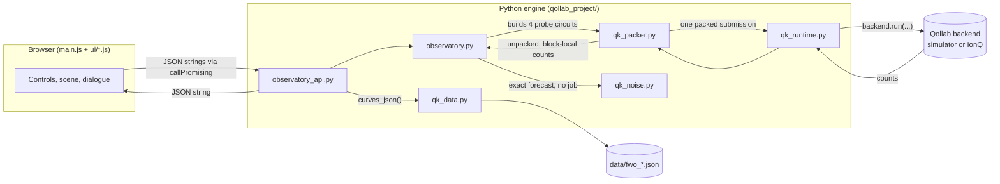

# Architecture

How the Observatory is put together, end to end: the Python engine's module layout, the
path from circuit to screen, the two Qollab entry points, and how the shipped datasets are
produced and loaded. See [docs/README.md](README.md) for the full documentation map,
[model.md](model.md) for the physics this engine implements, and [ui.md](ui.md) for the
browser side in detail.

## The big picture

One user action ("Run experiment") becomes exactly one `backend.run(...)` call carrying four
probe circuits plus canary blocks, packed into whatever shape the backend needs. Everything
downstream of that call — unpacking, bit-order correction, the three readings, the Hoeffding
interval, the persona explanations — is pure Python with no further quantum execution.

## Module responsibilities

| Module | Role | Imported by |
|---|---|---|
| `observatory.py` | The physics and the fiction: settings validation, circuit construction (`make_circuit`, `probes`), bit-order correction (`canonical_counts`), the three readings and their interval, the exact/closed-form model, the persona explanation text, and `run()` — the one function that drives an actual job. | `observatory_api.py`, `main.py` |
| `observatory_api.py` | The JSON bridge the browser calls: `profile_json`, `predict_json`, `run_json`, `explain_json`, `curves_json`. Every function takes/returns JSON strings, never raises, and loads the shipped datasets by literal path. | `main.js` (as `observatory_api`), `main.py` |
| `qk_runtime.py` | The Qollab harness: classifies whatever `backend` object was injected (`backend_profile`), decides the packing mode (`preferred_mode`), transpiles if needed (`prepare`), and enforces **one `backend.run` per run** (`run_once`, `begin_run`, `jobs_submitted`). Never constructs a backend. | `observatory.py`, `qk_packer.py`, `qk_mitigation.py` |
| `qk_packer.py` | Lays out one or more circuit "blocks" (a circuit plus the qubits to measure) into a single submission — `tile` (all blocks side by side on one circuit), `list` (one circuit per block, one list job) or `tiles` (first-fit packing into multiple tiles). Adds the orientation and readout-calibration canary blocks and unpacks block-local counts afterward. | `observatory.py` |
| `qk_noise.py` | The exact in-browser noise dial: evolves the full density matrix under depolarizing gate noise and classical readout flips, for circuits small enough to afford it (`MAX_QUBITS = 10`). Backs the Demon's "IonQ-like" forecast and the shipped noise curve. | `observatory.py`, `observatory_api.py` |
| `qk_data.py` | Dataset plumbing: builds, serializes and validates the `data/fwo_*.json` files (schema tag, generator, git commit, timestamp, library versions, machine class), and provides `json_safe` (NaN/inf → null) for every JSON response. | `observatory_api.py`, `lab/sweep.py` |
| `qk_primitives.py`, `qk_bounds.py`, `qk_estimators.py`, `qk_mitigation.py`, `qk_cards.py` | A general Bell/CHSH toolkit (Bell-state prep, classical/quantum bound computation, witness estimators, readout and ZNE mitigation, claim-card rendering), built and validated end to end on the CHSH reference project before the Observatory existed. Shipped alongside the Observatory (see [SUBMIT.md](../SUBMIT.md) §4) for reuse, and exercised by `tests/` and `reference/chsh/`, but **not called by the Observatory's own run path** — `observatory.py` only reaches into `qk_data`, `qk_noise`, `qk_packer` and `qk_runtime`. | `reference/chsh/`, `tests/`, `smoke/` |

The toolkit split matters for anyone extending the project: the Observatory-specific physics
lives entirely in `observatory.py`; everything it calls below that line is backend plumbing
general enough to run a different circuit family (see [Replicate & extend](../README.md#replicate--extend)
for the CHSH-probe extension idea in docs/model.md's wave–particle-duality note).

## One run, traced

1. **Browser → Python.** `main.js` calls `api.run_json.callPromising(backend, JSON.stringify(draft))`.
2. **Validate.** `observatory_api.run_json` parses the JSON, calls `observatory.validate_settings`
   (raises `ValueError` on anything out of range or ill-typed — before any job is touched),
   and classifies the backend via `qk_runtime.backend_profile`.
3. **Build.** `observatory.probes(settings)` builds the four `qk_packer.Block`s (`display`,
   `intent_low`, `intent_high`, `connection`), each a 2-qubit `QuantumCircuit` from
   `make_circuit`.
4. **Pack.** `qk_packer.pack(blocks, max_qubits, mode, canary=True)` lays the four probe
   blocks and three canary blocks onto disjoint qubits of one circuit (`mode="tile"`, the
   common case: a 17-qubit circuit, 8 probe qubits + 9 canary qubits) or as one list job of
   7 small circuits (`mode="list"`, used for the in-browser IBM noise models).
5. **Prepare and run.** `qk_runtime.prepare` transpiles if the backend needs it;
   `qk_runtime.run_once` makes **the one** `backend.run(...)` call, raising before submission
   if a one-job backend (IonQ) has already been used this page load.
6. **Unpack and correct.** `qk_packer.unpack` splits the returned counts back into per-block,
   block-local (Qiskit bit order) dictionaries; `observatory.canonical_counts` reverses each
   two-bit key exactly once into the app's SelfWorld convention.
7. **Read out.** `observatory.metrics(counts)` computes Capacity (with its Hoeffding 95%
   interval and `resolved` flag), Openness and Connection; `observatory.prediction` computes
   the same readings exactly (no sampling) for the Demon's forecast; `observatory.explanation`
   turns both into the factual sentence and the three persona lines.
8. **Back to the browser.** `observatory_api.run_json` assembles the full result dict (status,
   settings, source/provenance, counts, metrics, prediction, explanation, baselines) and
   serializes it with `qk_data.json_safe` so no NaN/Infinity ever reaches `JSON.parse`.
9. **Render.** `main.js` and `ui/readings.js`/`ui/scene.js`/`ui/chart.js` turn the result into
   the futures, the readings cards, the chart, the drawer and the 3D (or flat-plate) scene.

Every step before the `backend.run` call is deterministic and re-checkable offline; only
step 5 touches an actual simulator or remote job, and it happens exactly once per click.

## The two Qollab entry points

Qollab inspects the uploaded project and prefers the JS entry if both exist:

| Entry | Files | Which code runs |
|---|---|---|
| **JS page** (the submission) | top-level `index.html` + `main.js` + `main.css` + `ui/*.js`, plus every `.py` module and `data/*.json` | `main.js` calls `observatory_api` directly in the browser tab (Pyodide); no server, no polling, nothing runs outside the browser. |
| **Python console** (fallback) | `main.py` + the same Python modules and data | Qollab's own harness builds a `backend` global, then runs `main.py`'s top-level code, then calls `main(intention_deg, world_coupling, perspective_deg, shots_per_probe, persona)` with literal defaults read from the signature. `main.py` imports `observatory` and `observatory_api` directly and prints a console report. |

Both entries share one engine; `tools/pack_for_qollab.py` decides which files to upload for
which entry (see [development.md](development.md#packaging-for-qollab)). The platform's
specific rules for each form — why `main.py` must never call `main()` itself, how data files
are detected, the JS import map, iframe restrictions — are catalogued in
[platform-notes.md](platform-notes.md); this document only covers how this project's own
code uses those rules.

## The shipped datasets

Three small JSON files travel with the project so the page can show precomputed curves
without recomputing them in the session (`qollab_project/data/`):

| File | Produced by | Shape | Used for |
|---|---|---|---|
| `fwo_theory.json` | `lab/sweep.py --experiment fwo_theory` | 101 rows over `w` ∈ [0, 1]; each row has `params.w` and the exact `capacity`, `p_low`, `p_high`, `connection_bits`, `openness_bits`, `p_self_1` | The theory curve in the "How sure can we be" drawer |
| `fwo_noise.json` | `lab/sweep.py --experiment fwo_noise` | 40 rows over `scale` (0–80×) × `w` ∈ {0, 0.5}; adds `capacity_ideal`, `capacity_loss`, `noise_effective` | The Demon's noise-degradation view |
| `fwo_coverage.json` | `lab/sweep.py --experiment fwo_coverage` | 5 rows over `w` ∈ {0, 0.25, 0.5, 0.75, 1}; `capacity_exact`, `coverage_95`, `mean_width`, `resolved_fraction` from 2,000 seeded runs each | The calibration table proving the Hoeffding interval's coverage |

Every file is a `qk_data`-schema dataset: it carries its own generator command, git commit,
UTC timestamp, library versions and machine class, so a number quoted in
[claims.md](claims.md) or the README can be traced back to exactly how it was produced.
`observatory_api._theory_curve` / `_noise_curve` / `_coverage` load each file by a **literal**
relative path (`open("data/fwo_theory.json")`) — Qollab's uploader only bundles a data file
when its path appears as a string literal in the scanned source, so an f-string or
`os.path.join` here would silently ship a page that falls back to computing the curve live.
If a file is genuinely missing, each loader recomputes the exact curve in the session and
labels the result `"computed in this session"` rather than failing.

## Packing in more detail

`qk_packer.pack` is the one place that turns "four logical circuits plus two canary checks"
into "one `backend.run` call," because IonQ allows exactly one job per run and the built-in
simulator benefits from the same discipline:

- **`tile`** — every block's qubits are mapped onto disjoint qubits of a single wide circuit,
  each with its own classical register slice. One circuit, one job. This is what `mode=auto`
  picks for one-job backends and the built-in simulator (17 qubits total: 8 for the four
  2-qubit probes, 9 for the three canary blocks).
- **`list`** — each block becomes its own small circuit, and all of them are submitted
  together as one list-valued `backend.run([c1, c2, ...])` call — still one job, but many
  small circuits instead of one wide one. Chosen for the in-browser IBM noise models, whose
  density-matrix simulator runs several 2–3-qubit circuits far faster than one 17-qubit tile.
- **`tiles`** — a fallback when the blocks don't all fit one backend's `max_qubits`: first-fit
  packing into as few wide tiles as needed, still submitted as one list job.

Two canary blocks ride along whenever `canary=True` (the default): an **orientation** block
prepared as a non-palindromic bit pattern (`110`) so a reversed or scrambled qubit→clbit map
is diagnosed rather than silently absorbed, and **readout-calibration** blocks (all-|0⟩,
all-|1⟩) that measure the per-bit flip rates `P(1|0)` and `P(0|1)`. These are reported in the
run record (`bit_order_check`), never silently corrected.

This effort is supported by Qollab & IonQ
